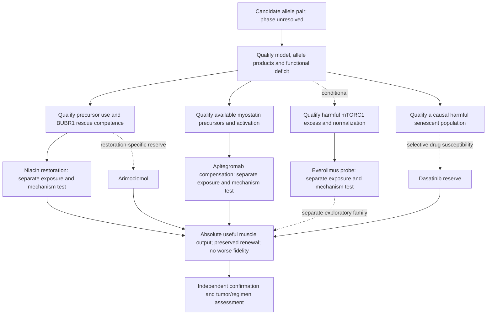

# Evidence pipeline for the Track 2 niacin–apitegromab comparison

22 September 2026. The provisional core pair is **niacin (nicotinic acid) for restoration**
and **apitegromab for downstream muscle compensation**, tested separately.
Niacin asks whether the NAD/SIRT2 route can restore usable BUBR1; apitegromab
asks whether selective inhibition of myostatin activation improves useful muscle
output despite the upstream lesion. Niacin has the closer BUBR1 mechanism bridge;
apitegromab has stronger randomized human muscle-function evidence, in SMA rather
than MVA. Neither has demonstrated actual-allele rescue or superiority here.
**Everolimus remains a conditional mTOR mechanism probe**, outside the core
confirmation family unless prospectively promoted. This revision follows the
[broad drug comparison](../../workflow/track2-drug-census/decision-report.md),
not measured MVA efficacy or an assumption of pediatric safety.

**Arimoclomol is a restoration-specific reserve; dasatinib is a reserve requiring
harmful senescent burden and selective susceptibility.** Senolysis has the
strongest same-gene organismal functional precedent considered, but its approved
drug implementation remains unvalidated. Qualify whether senescent cells cause
harm in parallel with the two core hypotheses; this does not promote a senolytic
drug to the lead. All require model, exposure and mechanism qualification;
none waits for another to fail. [Current proposal](../jeweled_track2_report_submission.md)
and [full alternative-route audit and promotion triggers](track2-route-decisions.md).

Candidate reconstruction, population sensitivity calculations and a secondary
mouse RNA analysis are completed. The [sixth source batch](../../workflow/track2-drug-census/batch06-revalidation-findings.md)
adds 128 literal revalidations, bringing coverage to 954, with 3,115 accepted outer
source/ID records, 2,644 pending strings and 142 curated appraisals. Its 22 new
source questions are flagged separately; the literature review remains incomplete.
No patient-cell, drug-exposure or functional
rescue experiment below has been performed; laboratory access is not secured.
This pipeline supersedes the elected-lead choices in the dated protocols while
retaining their useful assay controls. It supplies no clinical dosing proposal.

## Why this pair, and what remains to be proved

| Source | Established result | Missing bridge or counterevidence |
|---|---|---|
| [Suijkerbuijk 2010](https://pmc.ncbi.nlm.nih.gov/articles/PMC2887387/), abstract and Fig. 4D | Reported truncating-plus-missense architecture and abundance defects in selected MVA cells. In HeLa shRNA titration, about 6% BUBR1 caused missegregation in most cells; about 13% had little effect. Raising selected unstable mutants restored checkpoint challenge responses. | This supports an abundance-dependent mechanism, not a universal threshold. N1002K was not tested. HSP90 dependence does not demonstrate arimoclomol/HSP70 rescue, and restored challenge arrest does not establish complete tissue function. |
| [North 2014, Figs. 4–6](https://pmc.ncbi.nlm.nih.gov/articles/PMC4194088/) | NMN increased BUBR1 abundance in WT MEFs, largely through SIRT2, and in aged WT mouse testes. Genetic SIRT2 overexpression improved selected cardiac outcomes and male survival in BubR1 hypomorphs. | The drug experiments used 1 mM NMN for 24 hours in cells and 500 mg/kg/day intraperitoneally for seven days in mice. NMN did not supply the genetic survival result. WT/hypomorphic protein is not N1002K; small size, cataracts and lordokyphosis were not reversed by SIRT2 overexpression. |
| [Pirinen 2020, Fig. 3 and methods](https://www.brennerlab.net/files/Pirinen20.pdf) | Five mitochondrial-myopathy patients ([ages 17–70, Table S1](https://ars.els-cdn.com/content/image/1-s2.0-S155041312030190X-mmc1.pdf)) and ten matched healthy controls enrolled; both received niacin, escalated to 750–1,000 mg/day. Patient muscle NAD reached control levels. Strength improved in both groups; patient knee extension was 1.1-fold at ten months. Controls were followed for four months; two withdrew. | Nonrandomized, open-label, no placebo arm or BUBR1 measurement. Healthy controls were treated comparators, not untreated efficacy controls; this does not establish disease-specific strength rescue. Use as muscle NAD-engagement evidence. The ten-month patient and four-month control changes are not a matched-time comparison. The studied formulation and exposure do not establish an appropriate exposure for this child. |
| [Membrez 2024](https://pmc.ncbi.nlm.nih.gov/articles/PMC10963276/) | Human-myotube NA/NAPRT experiments provide a direct-utilization precedent; exact results below. | No BUBR1, mutant-function or clinical-exposure result. |
| [Nicotinic acid in toxin-exposed oocytes, 2025](https://pubmed.ncbi.nlm.nih.gov/40062928/) | Concurrent 15 micromolar nicotinic acid; human maturation means 56.7% with BaP+drug, 31.7% with BaP and 73.5% in controls (16/22/21 oocytes; three experiments). Mouse cellular protection and SIRT1 protein recovery are reported. | Figure 4C does not label a direct drug-plus-toxin versus toxin significance test; ns versus control is not equivalence. No SIRT2, direct NAD assay, niacin-induced BUBR1 restoration, euploidy or MVA muscle result. BUBR1 staining belongs to the toxin challenge. See [primary qualification](../../workflow/track2-drug-census/unfiltered-findings.md). |
| [Aaltio 2024](https://pubmed.ncbi.nlm.nih.gov/39173541/) | A child with MTTN myopathy had metabolic improvement after niacin corrected NAD deficiency. | Disease progressed with meager clinical response: NAD normalization alone is not useful tissue rescue. |
| [Niacin ER label, revised February 2026](https://dailymed.nlm.nih.gov/dailymed/fda/fdaDrugXsl.cfm?setid=dd60fe81-3d54-4a29-9502-601be89c575e) | Nicotinic-acid products have approved lipid-related uses. | Pediatric safety, effectiveness and pharmacokinetics are unestablished in this label. Formulation, liver, muscle and metabolic effects require review; approval does not establish an MVA indication. |
| [SAPPHIRE, PMID 40818473](https://pubmed.ncbi.nlm.nih.gov/40818473/) | In nonambulatory SMA on nusinersen/risdiplam, ages 2–12, combined apitegromab doses improved HFMSE versus placebo by 1.8 points (95% CI 0.30–3.32; p=.019). | The 20 mg/kg comparison alone was not significant (1.4; CI −0.34–3.13; p=.11). Older participants were exploratory. No BUB1B/MVA rescue; preserve dose, age and background-treatment distinctions in the [detailed appraisal](../../workflow/track2-drug-census/apitegromab-review.md). |
| [FDA approval, 11 September 2026](https://www.fda.gov/drugs/news-events-human-drugs/fda-approves-first-therapy-target-muscle-loss-spinal-muscular-atrophy); [ISEMBYLD label](https://dailymed.nlm.nih.gov/dailymed/drugInfo.cfm?setid=b1cd8ab8-8a10-48ed-9806-75a44f22b963) | US-approved apitegromab-mstn for SMA from age two on SMN2-targeted treatment; a defined precursor-targeting antibody implementation. | Not an MVA indication. Fractures, including serious events, and animal bone/reproductive findings matter. A muscle-culture result cannot establish systemic or RMS safety; no pediatric MVA dose is inferred. |
| [Long 2019](https://pmc.ncbi.nlm.nih.gov/articles/PMC6423420/); [EMBRAZE 2026](https://www.nature.com/articles/s41591-026-04440-4) | Related antibody muSRK-015P improved absolute torque in SMN-restored SMA mice, including a model with reduced circulating latent myostatin. Apitegromab preserved lean mass during tirzepatide treatment in adults. | Mouse torque normalized to mass did not improve; the mouse antibody is not apitegromab monotherapy. EMBRAZE found no notable physical-function difference. Neither high myostatin nor greater mass is a substitute for measured functional response. |
| [Sieben 2020, Fig. 5C](https://www.jci.org/articles/view/126863/figure/5) | Visually stronger phospho-p70S6K/phospho-4EBP1 bands in three-month-old BubR1+/X753 gastrocnemius than WT or BubR1+/L1002P; two mice per genotype, with Ponceau S loading control. Both mutant groups are monoallelic carriers. | No total S6K/4EBP1 denominators, band quantification or inferential statistics for panel C. Qualitative bands do not establish increased pathway activity, biallelic MVA1 signaling or drug rescue. The RNA result neither validates nor refutes this observation. |
| [Choi 2016](https://pmc.ncbi.nlm.nih.gov/articles/PMC5560052/); [Choi 2019](https://www.nature.com/articles/s41467-019-09318-3) | BUBR1 participates in insulin-receptor (IR) endocytosis; its depletion delays uptake in cultured cells. Hypomorphic mice have increased insulin sensitivity. | No N1002K-to-myogenic-mTORC1 demonstration. The 2019 SHP2 intervention prolonged liver AKT signaling, but not muscle AKT; that intervention is distinct from BUBR1 deficiency. |
| [Everolimus label](https://dailymed.nlm.nih.gov/dailymed/fda/fdaDrugXsl.cfm?setid=2150f73a-179b-4afc-b8ce-67c85cc72f04) | Established mTOR inhibition and pediatric approved-use experience in specified TSC indications support a concrete drug implementation. | Neither establishes harmful mTORC1 excess, a useful exposure window or functional benefit in BUB1B-associated disease. |
| [Tang 2011](https://pmc.ncbi.nlm.nih.gov/articles/PMC3532042/) | Rapamycin, Torin1 and mTOR knockdown did not preferentially inhibit trisomic MEF accumulation or enhance AICAR's effect. | A negative for that antiproliferation hypothesis; muscle-function rescue was not tested. It supplies no support for an aneuploid-cell-killing rationale for everolimus. |
| [González-Blanco 2026, Fig. 6 and Supplementary Fig. 6](https://pmc.ncbi.nlm.nih.gov/articles/PMC13121444/) | In a fly neural-stem-cell model using bub3 depletion, autophagy-promoting genetic interventions and rapamycin feeding increased retained neuroblast counts. | Genetic autophagy promotion did not restore progeny counts or brain size. More surviving stem cells therefore did not establish productive tissue rescue. This is a different gene, tissue and species; no everolimus, N1002K or muscle response was established. |
| [Arimoclomol studies: Gaucher 2018](https://doi.org/10.1016/j.ebiom.2018.11.037), [NPC 2025](https://doi.org/10.1016/j.ymgme.2025.109103) | Mutant lysosomal-protein processing/function and stress-response pathways can improve in the tested settings. | Neither demonstrates BUBR1 rescue. High nominal concentrations and different protein compartments limit transfer; see the [exposure review](mechanistic-bridge.md). |
| [MIPLYFFA label, March 2026](https://dailymed.nlm.nih.gov/dailymed/lookup.cfm?setid=5feffc0e-453d-47fa-91dd-38d4952309bc&version=5) | Arimoclomol with miglustat has an NPC indication from age two; estimated pediatric mean serum peak is 523 ng/mL, approximately 1.67 micromolar. | Its clinical mechanism in NPC remains unknown. Pediatric use elsewhere does not establish exposure-qualified BUBR1 rescue. |
| [Baker 2011](https://pmc.ncbi.nlm.nih.gov/articles/PMC3468323/) | INK-ATTAC-mediated clearance of p16-positive cells improved selected tissue and exercise outcomes in BubR1 hypomorphs. | Genetic selective clearance does not validate dasatinib or D+Q selectivity or functional rescue in this genotype. |

Niacin's restoration rationale and apitegromab's compensatory rationale earn
separate tests under the same functional criteria; the niacin-to-functional-BUBR1
bridge remains to be established in the actual model. **NMN is a mechanistic
reference, not an approved-drug nomination**;
dietary-ingredient status is not drug approval. Niacin, nicotinamide/niacinamide,
NMN and genetic SIRT2 elevation are distinct interventions. North's high-dose
nicotinamide experiment reduced BUBR1, so vitamin-family naming cannot determine
the direction of effect. [BUBR1 K250 experiments](https://doi.org/10.1016/j.bbrc.2014.09.128)
also separate SIRT2-dependent acetylation, total protein and checkpoint behavior.

## 1. Qualify the allele products and model

### First execution milestone and dependencies

Begin with drug-free affected-versus-corrected myogenic qualification, retaining
procedural controls, allele-product measurements and independent editing/preparation
identities. The first go/no-go output is a reproducible, genetically interpretable deficit
in absolute stimulated muscle output, or a documented failure to qualify that
model. Failed maturation, measurement or genetic rescue leaves the system
unresolved; it does not show that a drug failed. The phase stop and engineered-model
qualifications below apply before interpreting this as the child's disease.
If that model qualifies, the next small assay-qualification pilot establishes
niacin utilization and an available, activatable myostatin precursor system in
each functional cohort. Proceed to a candidate's regimen pilot only when its
engagement readout is interpretable; otherwise repair that assay or record
infeasibility. This is the first feasible staged decision, not a claim that a
laboratory, material or instrument has been secured.

| Work package | Required capability and proposed responsibility | Deliverable and next decision |
|---|---|---|
| Access and genetic interpretation | Prospective genetics/cell-engineering partner; authorized material and genotype/phase verification. Access is unconfirmed. | Model origin, allele configuration and controls established; apply confirmed-cis stop and label engineered alternatives. |
| Drug-free muscle qualification | Prospective muscle laboratory; differentiation, stimulation/force measurement, viable-tissue accounting and allele assays. | Masked affected-versus-corrected comparisons; identify a functional deficit that genetic correction improves, or document why interpretation failed. |
| Mechanism and exposure | Qualified model plus analytical/pharmacology support; niacin utilization/BUBR1 function, myostatin precursor activation/antibody engagement and measured exposure. mTOR studies are conditional. | A justified mechanism/exposure window, or a specific unresolved limitation. Nominal concentration alone cannot qualify exposure. |
| Separate drug pilots | Qualified cultures, matched vehicle/isotype controls, randomization, masking and complete outcome accounting. | Select one regimen each for niacin and apitegromab; estimate variance/missingness and freeze margins and independent confirmation size. Keep conditional probes exploratory. |
| Independent confirmation | Fresh preparations, both functional cohorts, the four-claim rule below and oncology compatibility review. | Advance only an implementation meeting functional, renewal, fidelity, exposure and compatibility requirements. |

Only public-data computation and the documented analyses are currently available.
Cell access, laboratory staffing, instrument throughput, analytical capacity and
costs remain unconfirmed. A partner must establish these before a budget or
schedule can be committed. This initial milestone does not replace downstream
confirmation in both functional cohorts or supply invented power estimates.

### Allele and model qualification

Verify genotype/phase where possible, RNA/splicing, allele-specific expression,
full-length versus truncated BUBR1, localization and baseline chromosome state.
Use affected, genetically corrected, parental cell line and sham controls, retaining
independent editing-family and preparation identities. Relevant myogenic models
must have a reproducible functional deficit before a muscle-rescue claim is tested.
Failure to generate a mature model is a feasibility failure; a negative fibroblast
result cannot exclude a muscle-specific defect.

If using engineered models, label them explicitly and retain both phase
configurations until resolved. In cis, canonical translation from the stop-bearing
allele masks downstream N1002K; the other allele can supply WT protein. This does
not establish half-normal functional dose. In trans, the missense allele can supply
full-length protein, but its abundance/function and the stop allele's RNA/protein
survival remain unmeasured. [Sequence reconstruction](../../workflow/track2-model/README.md)
is conditional; [pseudokinase-domain evidence](https://pubmed.ncbi.nlm.nih.gov/33207204/)
precludes assuming a surviving truncation is fully functional.

**Confirmed cis retires this pair as the compound-heterozygous explanation.**
Absent another pathogenic allele, the configuration is `[L737Ter;N1002K]/WT`,
not established biallelic MVA1. Suspend advancement of the patient-specific drug
rationale on that biallelic premise. A BUB1B causal explanation could continue only
with independently demonstrated evidence for an additional pathogenic allele in
trans or a dominant mechanism; that would be a different causal hypothesis. Uncertain WT
protein dosage, a carrier-mouse phenotype or an isolated drug response cannot
supply the missing genetic mechanism. Resolve phase early. Explicitly engineered
cis/trans models may inform biology while phase is unresolved, but a cis model
cannot be relabeled compound heterozygous or used to bypass this stop.

A protein below detection may be rapidly degraded rather than unsynthesized. An amount equal to one WT allele is a comparator, not
a validated threshold for sufficient function.

### Separate transcript rescue from protein rescue

NMD inhibition seeks more stop-bearing RNA and potentially a truncated product;
readthrough seeks translation beyond the stop. Measure endogenous allele-specific
RNA, its response to a qualified decay perturbation, and both truncated and
full-length protein. Intronless expression can test a product but cannot establish
endogenous NMD escape. Their mechanisms and products must be distinguished even
when one compound affects both.

In [Suijkerbuijk 2010](https://pubmed.ncbi.nlm.nih.gov/20516114/), historical
"731X" was a splice-associated frameshift truncation (IVS16-2A>G; S714fsX731),
distinct from Leu737Ter. Reduced patient RNA suggested decay. Expressed LAP-731X
retained the tested checkpoint, alignment and attachment functions. The [2020 study](https://pubmed.ncbi.nlm.nih.gov/33207204/)
found impaired KARD phosphorylation, PP2A-B56 recruitment, silencing and alignment
with pseudokinase alterations at matched kinetochore abundance. Arrest activation
and timely checkpoint silencing test different functions; retain both assay and
expression context rather than declaring the domain universally dispensable or
every truncation useless. These differences offer a possible reconciliation,
not a directly demonstrated explanation of the studies' different results.

Test the actual 1–736 product at justified abundance for recruitment, spontaneous
segregation, productive divisions and timely mitotic exit. Useful truncated
function would support investigating transcript stabilization; impairment or
interference would weaken that strategy. [Amlexanox](https://pmc.ncbi.nlm.nih.gov/articles/PMC3562214/)
has reported NMD and readthrough effects in other systems, so it is not a selective
NMD-only control or an established BUB1B rescue. Readthrough additionally requires
identifying the produced sequence and its function. [Azithromycin](https://doi.org/10.1007/s00109-015-1364-1) is a serious
conditional readthrough comparator: Caspi's unrelated patient-fibroblast
experiments included 0.1 microgram/mL over seven days. That nominal culture
concentration does not establish sustained free drug exposure at muscle
ribosomes, even when it overlaps a reported plasma peak. Test the actual UGA-A
sequence in endogenous transcript context, quantify allele-specific RNA and
readthrough, identify the amino acid inserted at the stop, and require functional
full-length protein. A reporter or a larger band alone cannot establish rescue.
No compound inherits BUB1B efficacy from a different gene or stop context.

## 2. Qualify the core mechanisms and conditional probes

Genotype does not establish NAD limitation, myostatin responsiveness, mTORC1
excess or treatment response.
Qualify the relevant mechanism in the same model before interpreting its drug
test; failed models or assays are not candidate exclusions.

### Niacin: core restoration hypothesis, with arimoclomol as a reserve

Separate rescue of quantity from rescue of quality.

Titrate WT, N1002K and the actual 1–736 truncation in defined allele backgrounds
across measured physiological protein amounts,
using comparable expression systems and controls for localization, cell state,
arrest and viability. Rescue must include spontaneous chromosome segregation and
productive progenitor output; checkpoint challenge is an additional readout.
Measure protein turnover and function at matched abundance rather than treating
a stronger band as a corrected allele. Determine whether the truncated product
helps, is inert or interferes; expression constructs may bypass endogenous NMD.

The [PP2A-B56 structure](https://pmc.ncbi.nlm.nih.gov/articles/PMC4930772/)
places K668 beside the core LxxIxE motif (L669–E674). K668A weakened binding modestly;
it did not test K668 acetylation. Pair abundance/turnover measurements with
BUBR1-normalized B56 association and kinetochore recruitment in matched mitotic
preparations. Use paired lysates and imaging samples: a bulk lysate cannot measure
kinetochore localization. Neither preservation of K668 nor recruitment alone
establishes functional rescue; the SIRT2 stability link and phosphatase recruitment
remain distinct hypotheses.

If additional N1002K restores function, an abundance-limited route earns support.
If expression-matched N1002K remains defective, quantity stabilization alone loses
priority. That failure **does not exclude chaperone-mediated improvement of folding
or function per molecule**; arimoclomol would then need to demonstrate that distinct
effect. If neither WT correction nor a qualified WT rescue restores the phenotype,
resolve the model/background before assigning drug failure to this mechanism.

For niacin, measure baseline and drug-induced intracellular NAD, SIRT2 expression
and a validated activity readout, then BUBR1 turnover and tissue function. NAD
deficiency is an unknown to measure, not a mandatory inclusion criterion. Compare
a suitable SIRT2 perturbation with its rescue or catalytically inactive control; account for effects on baseline BUBR1, viability
and cell cycle. NMN provides a pathway reference, not an interchangeable exposure.
For arimoclomol, distinguish inducible/constitutive HSP70-family responses and
HSP90-related effects from BUBR1 amount, localization and function. Neither a
chaperone marker nor correlation between NAD and BUBR1 proves causal rescue.
SIRT2 dependence alone does not establish BUBR1 dependence: SIRT2 has other
substrates. The [NQO1/NMN experiment](../../workflow/track2-drug-census/nqo1-sirt2-followup.md)
provides a concrete example: reported mitotic completion can improve through a
pathway linked to APC/C, without establishing BUBR1 rescue or daughter-cell
fidelity. N1002K-specific SIRT2 interaction is unmeasured; neither preserved
nor disrupted binding follows from its sequence position. To claim the full chain, use an interpretable BUBR1 abundance clamp
or orthogonal perturbation, with titration that preserves baseline function and
NAD engagement. Severe depletion that destroys the baseline cannot answer this
question. If that causal test is infeasible, retain functional benefit as an
observation without claiming that the restoration mechanism is established.

### Qualify niacin utilization

Published NAD responses relative to each control:

| Panel / source data | Exposure and result | Interpretation |
|---|---|---|
| [Extended Fig. 1f, rows 77–90](https://media.springernature.com/full/springer-static/esm/art%3A10.1038%2Fs42255-024-00997-x/MediaObjects/42255_2024_997_MOESM6_ESM.xlsx) | NA 1 mM/24 h: 127.47%; Šídák-adjusted P=0.454; n=6. | Nonsignificant multi-precursor comparison. |
| [Extended Fig. 2e, rows 175–189](https://media.springernature.com/full/springer-static/esm/art%3A10.1038%2Fs42255-024-00997-x/MediaObjects/42255_2024_997_MOESM7_ESM.xlsx) | Scrambled-shRNA + NA: 131.15%, P=0.0017; NAPRT-shRNA + NA: 107.55%, P=0.1278; n=6/group; 24 h. | Within-group tests; NA concentration not restated; no FK866 indicated. |

Similar effect estimates need not contradict each other when statistical tests
differ. The second panel reports no interaction test. Replicates are not established
as independent donors. Do not transfer trigonelline's functional results to NA.

Measure NAPRT and downstream precursor-processing capacity in the actual human
progenitor and differentiated cultures, together with baseline medium/serum
nicotinic acid and nicotinamide content. Expression alone is insufficient: establish
concentration/time-dependent precursor utilization and NAD response with a qualified
assay, retaining isotope tracing as an orthogonal option where available. Do not
create an artificial deficiency solely to produce an attractive rescue result;
any induced-deficiency control stays separate from the genotype comparison.

Use the Membrez experiment as a mechanistic positive precedent, not as the selected
exposure. The NAPRT-poor C2C12 negative is a warning about model choice. Confirm the
relevant activities in both muscle-supporting progenitors and mature myotubes;
results in differentiated human cells cannot be assumed to apply to every progenitor state.
If NAD fails to respond despite measured exposure, distinguish absent utilization
from a defective downstream SIRT2/BUBR1 link. NMN/NR reference responses cannot
rescue a failed nicotinic-acid implementation by substitution.

[Mouse isotope tracing](https://pmc.ncbi.nlm.nih.gov/articles/PMC5932087/)
demonstrates that tissue NAD supply can depend on circulating metabolites and
route of administration. Thus a parent-drug-only culture failure does not by itself
exclude a systemic precursor mechanism. Testing that alternative requires measured
metabolite exposure and an appropriate model; hypothesized liver or microbiome
conversion cannot excuse an unresponsive assay or be counted as niacin success.
The NMN, NAM and nicotinic-acid routes are not interchangeable. In particular,
North's high-dose nicotinamide inhibition does not establish that lower-dose
nicotinamide can never raise NAD; any alternative needs its own drug and functional
case instead of inheriting niacin's nomination.

### Apitegromab: core downstream compensation hypothesis

Qualify the actual antibody's binding to the model's promyostatin and latent
myostatin, including species compatibility. Measure precursor availability,
activation and downstream response in progenitors and mature muscle separately;
an expression band or a total serum-style latent-myostatin assay alone cannot
establish active signaling. The [phase 1 pharmacology](https://pmc.ncbi.nlm.nih.gov/articles/PMC8189951/)
supports precursor engagement, with increased total latent myostatin after
binding. That accumulation must not be interpreted as increased active myostatin.

Use a matched nonbinding isotype and formulation/handling controls. Pair actual
apitegromab with a qualified orthogonal MSTN perturbation, retaining on-target
controls and baseline viability/function. Calibrated precursor-activation and
active-ligand controls can distinguish inhibition of activation from downstream
unresponsiveness; artificially imposed myostatin injury remains a separate assay
control, not the evidence of genotype rescue. Generic follistatin or activin-
receptor blockade cannot inherit apitegromab's selectivity or serve as proof of
its mechanism. Do not require elevated baseline myostatin: the [SMA mouse
precedent](https://pmc.ncbi.nlm.nih.gov/articles/PMC6423420/) supports compensation
despite lower circulating latent myostatin.

Measure antibody concentration, stability, target engagement and persistence over
a justified observation period. Plasma dose and culture concentration are not
interchangeable; dosing from another pediatric indication supplies no MVA regimen.
If the target/activation system is absent, the model cannot give an interpretable
apitegromab null. If it is present and engaged but absolute force fails to improve,
record the implementation-specific result. Increased size, lean mass or fusion
alone cannot pass. Apply the same renewal and chromosome-fidelity preservation
criteria as for niacin; useful compensation need not restore BUBR1. Bone outcomes,
development and RMS compatibility require assessment beyond muscle culture, as
specified below.

### Everolimus: conditional mTOR mechanism probe

Qualify this exploratory hypothesis alongside the core tests by testing
for genotype-associated excess signaling at matched maturation, density,
nutrients and cell composition; restoration failure is not a prerequisite.
Measure phospho/total p70S6K and 4EBP1 and, where relevant, autophagy flux. The
[Sieben blot](https://www.jci.org/articles/view/126863/figure/5) has only the
qualitative, monoallelic-carrier evidence described above. It does not establish
increased pathway activity. Our [GSE134781 analysis](../../workflow/track2-rna/README.md)
found no positive mTORC1 Hallmark corroboration (X753–WT P=0.219; global FDR=0.983).
That transcript analysis neither validates nor refutes the band observation and
cannot replace phospho/total measurements and independent functional tests.

Retain adverse evidence: [Baker 2013](https://pmc.ncbi.nlm.nih.gov/articles/PMC3785294/)
mentions similar age-phenotype development in rapamycin-fed and control BubR1
progeroid mice in a parenthetical explicitly attributed to unpublished data;
there is no reported treatment figure or complete regimen, and it is not a
fully reported negative trial. [Goutas 2023, Fig. 6](https://pmc.ncbi.nlm.nih.gov/articles/PMC10149375/)
found that 50 nM everolimus for 24 hours reduced BUBR1 in late-passage WJ-MSCs,
with no corresponding early-passage reduction. This is a cell-state-specific
warning, not a mutant experiment or proof of harm in MVA. These concerns justify
monitoring and decision criteria; they do not establish arimoclomol superiority.
Normal signaling, failure of function despite target engagement, or loss of
BUBR1/renewal would move everolimus down. Functional rescue at justified exposure
would support advancement; compare absolute output rather than biomarker change alone.

The [2026 bub3-depleted fly study](https://pmc.ncbi.nlm.nih.gov/articles/PMC13121444/)
provides a separate TOR/autophagy intervention precedent: rapamycin feeding and
autophagy-promoting genetic interventions retained more neural stem cells.
The genetic interventions failed to restore progeny counts or brain size.
This result cannot establish excessive mTORC1 activity in this child's muscle,
but supplies a concrete reason to distinguish progenitor survival from productive
tissue formation. Test autophagy flux and subsequent productive differentiation;
do not count retained stem cells alone as functional rescue. Sirolimus is the
actual drug reference for this observation; transfer to everolimus must be tested.

If excess signaling is qualified, titrate partial inducible RPTOR attenuation
toward the corrected-cell range with independent targeting/on-target controls.
Complete knockout is not the intended intervention. Test both functional cohorts;
genetic success must then be implemented separately by exposure-qualified
everolimus, with sirolimus as the actual rapamycin reference compound.

Compare continuous exposure with finite pulses followed by verified washout over
the same observation period. Match handling, record cumulative exposure and state
whether the contrast tests a whole regimen or timing at comparable exposure.
Measure drug disappearance, signaling recovery/rebound, BUBR1, function and reserve;
washout alone is not recovery. No pulse schedule is presumed protective.
[Tsc1 myopathy rescue](https://pubmed.ncbi.nlm.nih.gov/23602450/), opposing regeneration
contexts ([Ge 2009](https://pmc.ncbi.nlm.nih.gov/articles/PMC2793064/),
[Balnis 2025](https://doi.org/10.1172/jci.insight.182842)), and the
[negative older-adult functional trial](https://doi.org/10.1002/jcsm.70274)
justify testing the window rather than declaring benefit from pathway inhibition.

#### Conditional follow-up: insulin-receptor trafficking

If the matched affected/corrected comparison establishes mTORC1 excess, use the
same preparations to test whether altered IR trafficking supplies an upstream
explanation. This is a prospective mechanistic branch, not another medication
nomination or an experiment required before submission. The Choi studies above
motivate it, but their cell-line/liver evidence does not establish this mechanism
in affected muscle. C-terminal interaction mapping is not a functional assay of
N1002K or the actual truncation.

The [Sieben discussion](https://www.jci.org/articles/view/126863/version/2)
already proposed this upstream connection; it remains a hypothesis. Its different
qualitative band patterns across monoallelic carriers cannot establish a universal
pathway response to low BUBR1. [Park 2023](https://pubmed.ncbi.nlm.nih.gov/37725942/) genetically
disrupted IR–MAD2 binding and found delayed endocytosis/prolonged surface signaling,
but also impaired insulin clearance and altered circulating hormones. This extends
the trafficking evidence without establishing harmful myogenic mTORC1 activation;
isolated cells will not model those systemic feedbacks.

1. **Resolve uptake and signal duration together.** Compare affected and isogenic
   corrected cells, retaining independent editing/preparation controls. Analyze
   progenitors and differentiated myotubes separately at matched density,
   maturation and nutrients. Under defined insulin stimulation and withdrawal,
   follow endogenous surface-labeled IR into the cell with a validated uptake
   assay, expressing uptake relative to the starting labeled surface pool.
   Measure recycling and total/surface receptor abundance separately;
   a surface-to-intracellular ratio alone cannot distinguish these processes.
   Verify that labeling does not change signaling. In matched samples measure
   phospho/total IR, AKT-T308 and ERK alongside p70S6K and 4EBP1 across activation
   and decay; record AKT-S473 separately if measured, not as an mTORC1 endpoint.
   Fix the insulin exposure, sampling window and duration/AUC comparisons
   after the pilot; a larger peak alone does not show prolonged signaling.
2. **Test the proposed connection.** Control insulin/IGF content and distinguish
   INSR from IGF1R engagement; receptor identity cannot be inferred from AKT alone.
   If delayed uptake and prolonged mTORC1 signaling co-occur, test partial,
   inducible INSR attenuation with on-target controls, titrated toward corrected
   signaling rather than removal of basal trophic support. This tests receptor
   dependence, not whether delayed uptake itself mediates the effect. Genetic
   correction also affects mitosis and need not erase prior karyotypic differences;
   document those differences and do not interpret coincident rescue as isolation
   of a direct nonmitotic mechanism. A trafficking-specific causal claim requires a
   qualified separation-of-function perturbation; do not assume one is available
   for these alleles.
3. **Establish whether the excess is harmful.** Retain the existing partial RPTOR
   test and absolute-function, renewal and fidelity criteria. Improved insulin
   responsiveness may be neutral or helpful. AKT elevation without mTORC1 excess,
   or marker normalization without functional gain, cannot justify everolimus.
   Cells and images remain nested observations under the existing replication
   plan; this exploratory branch does not enlarge the four confirmatory drug
   claims.

| Focused result | Interpretation |
|---|---|
| Delayed IR uptake and prolonged downstream activity reverse with correction; INSR dependence and beneficial partial RPTOR normalization are supported | Supports an IR-linked mTORC1 explanation; trafficking mediation and variant-specific action still require their own evidence. |
| IR kinetics are normal within a prespecified detectable effect, or an IR alteration does not track mTORC1 activity | Deprioritize this trafficking explanation in the tested state. A different cause of mTORC1 excess remains possible. |
| Longer signaling accompanies preserved or improved function, or its reduction impairs output/renewal | Do not label that response harmful or use it to favor pathway suppression. |

## 3. Compare exposure-qualified drug implementations

Test niacin and apitegromab in separate treatment arms in affected and corrected
cultures, with drug-appropriate vehicle/isotype and genetic controls above.
This is not a niacin–apitegromab combination proposal. Test everolimus,
arimoclomol or dasatinib separately if their conditional hypotheses are qualified.
Use pharmacologist-reviewed concentration/time
ranges and measure medium concentration, stability, binding and relevant cellular
engagement. Clinical total serum or blood concentrations are not culture-medium
free concentrations. Match handling and observation periods; compare justified
exposure and engagement rather than equal nominal concentrations between drugs.

Estimate drug-versus-matched-control effects within affected and corrected cultures at the
same endpoint, retaining baseline measurements where available. A pretreatment-to-
follow-up gain alone cannot pass: maturation, handling or repeated measurement
may alter output. Report each genotype's treatment contrast and its uncertainty;
assess specificity through their difference (the genotype-by-treatment interaction),
not by comparing which separate P values are significant. Include this contrast
and its inference status in the prespecified analysis plan; any confirmatory
specificity claim needs its own multiplicity treatment. A general benefit in both
genotypes can satisfy the functional rule, but does not establish selective
reversal of the disease defect or BUBR1 mediation. Neither a nonsignificant
interaction nor a ceiling in corrected cultures proves equivalent responses.
This distinction addresses the treated-control strength gains in Pirinen without
assuming those gains were entirely practice effects or that niacin is ineffective.

Duration must be sufficient for each proposed mechanism before a negative response
is called interpretable. High-exposure mechanistic controls can inform biology but
cannot pass the repurposing gate. Record formulation and active analyte; a clinical
niacin dose, an NMN mouse injection, an antibody infusion and a culture
concentration are not equivalents. For apitegromab, qualify accessible extracellular
precursor engagement and antibody persistence rather than assuming small-molecule
intracellular exposure criteria apply unchanged.
Target engagement without functional benefit rejects that implementation only
within the qualified exposure, duration, tissue and genotype tested.

## 4. Require useful output in two separate functional cohorts

| Cohort | Primary question | Required accounting |
|---|---|---|
| **Progenitors through differentiation/replacement** | Does treatment improve absolute functional muscle yield per starting cohort while preserving renewal and not worsening chromosome fidelity in dividing populations? | Track founders, non-entry, completed divisions, daughter outcomes, arrest, death, tracking loss, clone expansion, differentiation and total viable muscle output. Measure later absolute contractile output; a higher fusion percentage after cell loss cannot pass. |
| **Established mature muscle** | Does treatment improve absolute evoked contractile output per construct from the pretreatment cohort? | Record baseline/follow-up force, viable tissue size, repeated-stimulation performance and deaths. Area-normalized force is secondary; contraction imaging is a surrogate if force is unavailable. |

The common advancement criterion is useful absolute muscle output with preserved
renewal and no worse chromosome fidelity against the prespecified comparison.
**Either cohort may supply the meaningful functional benefit, while output in the
other cohort, renewable progenitor reserve and fidelity must meet their preservation
margins.** Both cohorts need not improve. This symmetric rule allows mature-muscle
benefit without greater replacement, or greater progenitor-derived output without
greater established-muscle force; it does not allow one benefit to cancel harm
elsewhere. Cohort outputs remain separate rather than being pooled into a score.
Freeze useful-benefit and acceptable-loss boundaries prospectively; a nonsignificant
difference is not proof of preservation. A claim of BUBR1 restoration additionally
requires relevant BUBR1-dependent functional and fidelity evidence. Downstream
myostatin-mediated compensation, or a separately qualified mTORC1 benefit, need not
correct the existing mitotic defect, provided it meets the
common functional and preservation criteria. Conditional senolysis likewise must
show that selective clearance improves net function while preserving replacement;
it need not correct segregation in surviving cells. Report each mechanism claim
separately from the common functional result.

Use the [founder ledger](founder-ledger.md) to retain the starting denominator and
unscorable outcomes; do not analyze only surviving or dividing cells. Record both
error rate per completed division and total lineage output, because slower division
can improve a fraction while reducing replacement. Orthogonal chromosome-state
measurements distinguish new fidelity from selection of pre-existing clones.
The [population sensitivity calculations](../../workflow/track2-model/population-results.json)
illustrate this distinction; they are not observed drug effects or force predictions.

Mature-tissue benefit with unacceptable replacement loss fails advancement.
Follow function, growth and chromosome instability after withdrawal where feasible;
a transient marker change or delayed collapse is insufficient. An interpretable
benefit in one cohort cannot be silently generalized to the other.

## 5. Conditional reserves

A [BubR1-knockdown C2C12 study](https://pmc.ncbi.nlm.nih.gov/articles/PMC5023544/)
reported impaired myogenic differentiation/fusion. Its SA-β-gal assays were negative
at earlier population doublings than the fusion experiment; these are not paired
proof of senescence-independent dysfunction, and one marker does not exclude
senescence. The study tested no drug. It supports measuring the myogenic defect
and harmful senescent burden separately instead of assigning every BUB1B defect
to a senolytic-responsive population.

**Senolysis:** qualify whether a senescent-cell population causes harm alongside
the core restoration/compensation tests and conditional mTORC1 work; this route
need not wait for either core drug to fail.
Dasatinib monotherapy is a
conditional reserve: [fat-cell progenitor activity](https://pubmed.ncbi.nlm.nih.gov/25754370/)
does not establish selective susceptibility or function in muscle-supporting cells.
Arimoclomol is the restoration-specific reserve, without demonstrated superiority
to dasatinib. In fibro-adipogenic
progenitor/myogenic cocultures, use a selective-clearance reference and track both
populations, replacement and absolute muscle output to distinguish useful removal
from nonspecific killing. A lower senescence-marker fraction cannot pass alone.

[Dungan 2022](https://pubmed.ncbi.nlm.nih.gov/34904366/) found that D+Q improved
selected physical-function and injury-regeneration outcomes in old mice but
blunted regeneration in young mice. Marker-positive cells in young injured
muscle showed reparative macrophage characteristics. Therefore, distinguish a
persistent harmful population from a transient repair response, and require
preserved regeneration after clearance. Neither age nor a positive marker alone
establishes susceptibility or harm in the affected model.

The [same-model D+Q patent evidence](https://patents.google.com/patent/WO2015116735A1/en)
is marker-level evidence, not functional rescue or dasatinib-alone efficacy.
The [competition rules](https://huggingface.co/spaces/SageBio/rare-disease-real-kid-mva-hackathon-2026/blob/main/tabs/about.py)
do not expressly require an approved regimen or a US-only approval. The
[manufacturer lists QUERTIN (quercetin 40 mg) as a Ukrainian medicinal product](https://bcpp.com.ua/product/kvertin)
with prescribing instructions; current regulator status and the nominated
formulation/jurisdiction have not been independently verified for this submission.
Do not describe quercetin as globally unapproved. Retain D+Q as an experimental
comparator pending that eligibility check and its separate functional/selectivity
qualification; product approval would not validate a senolytic regimen for MVA.

The [full route audit](track2-route-decisions.md) records alternatives without
adding confirmatory drug arms here. Three findings sharpen their current gates:

| Route | Evidence that changes its gate |
|---|---|
| **Hydroxychloroquine / autophagy blockade** | The [HCQ label, §5.8](https://dailymed.nlm.nih.gov/dailymed/drugInfo.cfm?setid=e5fe2ece-40a1-49eb-818f-62ff3c3bb199) reports skeletal myopathy with progressive proximal weakness and atrophy. Reconsideration requires exposure-qualified absolute functional rescue with preserved lysosomal and muscle function; increased BUBR1 abundance or selective cell loss alone cannot pass. This weighs against an HCQ lead, without establishing an MVA-specific contraindication. |
| **N-acetylcysteine** | A [33-participant randomized RYR1-myopathy trial](https://doi.org/10.1212/WNL.0000000000008872) found no significant improvement in its oxidative-stress endpoint or six-minute walk distance after six months. This different-disease result does not exclude a BUB1B mechanism, but a measured redox abnormality alone cannot promote NAC: require causal redox injury and useful tissue rescue at justified exposure. |
| **IGF-1 / mecasermin** | The [INCRELEX label, §4, revised July 2025](https://dailymed.nlm.nih.gov/dailymed/drugInfo.cfm?setid=a8b27a1b-a611-4f91-ad22-76d4b390c3ae) contraindicates use in pediatric patients with malignant neoplasia or a history of malignancy. The recorded RMS history therefore excludes a patient-directed mecasermin nomination here; a laboratory growth-factor response cannot override that restriction. Growth hormone is a separate route and must not inherit this exact contraindication. |

## 6. Confirmation and decision outputs

Randomize and mask within preparation/editing-family blocks. Pilot data establish
tracking quality, variance, exposure duration and recovery. Before independent
confirmation, freeze primary contrasts, useful-benefit and acceptable-loss margins,
missing-data/exclusion rules and multiplicity policy. Biological preparations are
replicates; cells and repeated images are nested observations. Require uncertainty
intervals to meet the benefit/preservation margins; nonsignificant harm is not
evidence of preserved reserve. Cell counts or simulations cannot set sample size.

### Confirmatory benefit rule

For one qualified genotype/model, freeze one exposure regimen per drug and one
primary endpoint/time per functional cohort before independent confirmation.
The four possible claims are **niacin or apitegromab benefit in progenitor-derived
output or established-muscle output**. Each claim jointly requires improvement in
affected cultures versus the time-matched drug-appropriate control (vehicle for
niacin; matched nonbinding isotype for apitegromab) beyond the chosen useful-benefit
margin and preservation of the other cohort,
renewable progenitor reserve and chromosome fidelity. The latter comparisons use
predeclared acceptable-loss margins, not a failure to detect harm.

Use valid one-sided component tests at the independent preparation/editing-family
level, retaining pairing and nesting. For a joint claim, take the largest component
P value (the intersection–union rule: every required component must pass). Apply
Holm's step-down correction across the four joint-claim P values at family-wise
alpha 0.05. This controls false advancement opportunities without requiring an
arbitrary advantage for one mechanism. Report component effect estimates and
intervals with their adjustment status; the rule does not confer simultaneous
coverage on every displayed interval. [Endpoint logic and Holm procedure](https://www.fda.gov/media/162416/download),
[intersection–union methodology](https://doi.org/10.1016/j.jspi.2007.03.021).

Passing for one drug and not the other is not proof of a between-drug difference;
a superiority claim needs its own prespecified direct comparison.

Everolimus and other conditional probes belong to separately prespecified
**exploratory** analyses; they do not add or replace claims inside this four-claim
family after outcomes are seen. Promotion requires a prospectively expanded
confirmation family or a separate independent confirmation study, with its own
replication/power plan and multiplicity control. Do not reuse exploratory/pilot
observations as confirmation or count shared preparations/controls twice as
independent evidence. No extra confirmatory power is assumed for these probes.

Pilot observations select assay times, margins, exposure and an attainable
independent replication plan; they do not also serve as confirmatory evidence.
Retain an untested or uninterpretable claim as nonpassing in the four-claim family
rather than dropping it to ease the threshold. Additional confirmatory doses,
schedules, genotypes or endpoint times require an expanded prespecified family or
a separate independent study. Mechanistic attribution and tumor compatibility
remain separate required assessments; a functional claim supplies neither by
itself. These are prospective ex-vivo analysis choices, not clinical-trial results
or a claim of regulatory endorsement.

### Rhabdomyosarcoma evidence and treatment compatibility

The recorded RMS history makes oncology compatibility part of the proposed test.
For apitegromab, primary RMS cell studies do not establish a uniform direction:
blocking anti-myostatin antibodies promoted differentiation in [RD/Rh30 cells](https://pubmed.ncbi.nlm.nih.gov/14614446/),
whereas added myostatin suppressed proliferation in [another RD experiment](https://pubmed.ncbi.nlm.nih.gov/14724580/).
[BRD4-dependent experiments](https://pmc.ncbi.nlm.nih.gov/articles/PMC10897194/)
also found context-dependent responses. These were not apitegromab/MVA studies;
they establish neither tumor promotion nor recurrence safety for this candidate.
Keep precursor-selective antibody effects distinct from other myostatin blockers.

The conditional mTOR literature contains both class trials and direct everolimus
reports; they answer different questions and cannot be pooled into an assumed
anticancer benefit for this child.

| Primary clinical evidence | Finding | Consequence for this proposal |
|---|---|---|
| [ARST0921, first relapse/progression RMS](https://pmc.ncbi.nlm.nih.gov/articles/PMC6823886/) | Temsirolimus or bevacizumab, each with vinorelbine/cyclophosphamide: reported six-month event-free survival 69.1% versus 54.6%; final EFS comparison P=.018. No significant overall-survival difference. | Favors the temsirolimus-containing regimen over that comparator. No chemotherapy-only arm and no everolimus arm; it does not establish everolimus benefit. |
| [ARST1431, newly diagnosed intermediate-risk RMS](https://pubmed.ncbi.nlm.nih.gov/38936378/) | 297 evaluable participants; three-year EFS 66.8% with temsirolimus versus 64.8% without; HR 0.86 (95% CI 0.58–1.26), P=.44. Both groups received VAC/VI and maintenance treatment. | Adding temsirolimus did not demonstrate EFS improvement. The setting and comparator differ from ARST0921; mTOR inhibition is not a general guarantee of RMS benefit. |
| [ADVL1711, recurrent/refractory RMS](https://pubmed.ncbi.nlm.nih.gov/40313040/) | Single-arm lenvatinib plus everolimus: 2/20 partial responses (10%; 95% CI 1.2–31.7), lasting 2.10 and 2.76 months; did not meet the prespecified activity threshold. | Direct everolimus-containing clinical evidence exists, with limited activity. Neither response nor toxicity can be attributed to everolimus alone. |
| [Epelman, SIOP 2015 abstract O-052](https://siop-online.org/wp-content/uploads/2015/10/SIOP-2015-Abstracts-Nov-2.compressed.pdf#page=100) | Everolimus monotherapy: six RMS among 17 heavily pretreated sarcoma patients; one RMS partial response reportedly lasted 11 months. | A small direct signal, but abstract-only, without a comparator or complete RMS-specific outcomes. It supplies neither reliable efficacy nor survival evidence. |

None of these studies establishes benefit in BUB1B-associated MVA, and muscle
mTORC1 activation does not establish tumor dependence. The muscle hypothesis and
oncology compatibility therefore remain separate questions.

Confirm current tumor status, subtype/fusion status and the actual oncology
regimen before choosing tumor models and treatment comparators. For **each nominated
drug separately**, compare its matched control, candidate, confirmed oncology treatment and
candidate plus that treatment. Retain absolute viable tumor output and
post-withdrawal regrowth; early cytostasis is not durable tumor control. A
nonresponsive treatment control cannot establish compatibility. Prespecify an
acceptable tumor-protection margin and judge its uncertainty interval, rather
than interpreting nonsignificance as absence of interference. The [dated oncology
framework](oncology-counterscreen.md) supplies these general design principles;
its historical arimoclomol/NAC ranking does not govern the current candidates.

The [apitegromab label](https://dailymed.nlm.nih.gov/dailymed/drugInfo.cfm?setid=b1cd8ab8-8a10-48ed-9806-75a44f22b963)
reports fractures in 9% at the recommended dose versus 2% with placebo, serious
extension events and adverse animal bone/reproductive findings. Obtain the
relevant bone/fracture and developmental context before translational advancement;
increased muscle force cannot offset unmeasured skeletal harm. Its approximately
31-day half-life also limits assumptions about rapid washout or reversibility.
Carcinogenicity/genotoxicity studies were not conducted. Neither a short muscle
assay nor a tumor counterscreen establishes these systemic outcomes. Current SMA
approval, including pediatric use, supplies no dose or safety inference for MVA.

The [everolimus label](https://dailymed.nlm.nih.gov/dailymed/fda/fdaDrugXsl.cfm?setid=2150f73a-179b-4afc-b8ce-67c85cc72f04)
also makes radiation history, wound healing and actual interacting medicines
relevant to translational review. Recorded failure to thrive and muscle atrophy
make growth/renewal loss a decisive functional failure; recorded nephrocalcinosis
does not establish measured renal impairment. These clinical-context gaps cannot
be resolved by a tumor culture. Systemic growth, renal, hepatic, immune and
interaction effects remain outside cell-assay inference. No treatment schedule
or patient dose is inferred from the trials or labels.

Keep regulatory statements indication-specific. The transplant product
[ZORTRESS](https://dailymed.nlm.nih.gov/dailymed/fda/fdaDrugXsl.cfm?setid=e082a024-7850-400b-a5c2-2a140612562a&type=display)
has a malignancy/infection boxed warning tied to immunosuppression. The
AFINITOR/DISPERZ label does not carry that malignancy boxed warning and reports no
apparent growth/puberty impairment among 115 pediatric patients treated for a
median 4.1 years, with explicit limits from size and uncontrolled follow-up.
Neither proves safety in MVA. Preserve infection, wound-healing, metabolic and
functional-renewal concerns without declaring all chronic mTOR inhibition either
prohibited or safe.

[VAC contains vincristine](https://www.cancer.gov/about-cancer/treatment/drugs/vac),
a microtubule-directed oncology agent. Declining a mitotic poison as a new muscle
rescue lead does not establish that an indicated cancer regimen should be withheld.
Review the genetic/functional findings with the actual tumor-treatment context;
a normal result in one cell assay cannot cancel that review. This proposal supplies
no genotype-directed chemotherapy dose change or clinical avoid-list.

### Decision outputs

| Observation | Decision |
|---|---|
| Confirmed cis for the two nominated variants | Retire this pair as the compound-heterozygous explanation and stop advancing the current biallelic-MVA1 drug rationale. An independently demonstrated additional pathogenic allele in trans or dominant mechanism could justify a different causal hypothesis, never reclassify these two cis variants as compound heterozygous. |
| Model, niacin utilization, myostatin precursor/activation system, mechanism engagement, exposure, duration or functional measurement is inadequate | Uninterpretable nonresponse; repair the limitation or report infeasibility. Target absence in the assay is not apitegromab failure in the organism. |
| Qualified assays find no genotype-associated harmful mTORC1 excess | Deprioritize the proposed everolimus normalization mechanism in that model; neither genotype nor an unrelated pathway marker can substitute for the missing premise. |
| Additional N1002K quantity fails at matched physiological abundance | Deprioritize quantity-only rescue in that model; folding/function-per-molecule rescue remains a separate hypothesis. |
| Genetic/mechanistic rescue works but an adequately engaged drug does not improve function | Target success, drug-implementation failure; do not discard the target or award the drug genetic efficacy. |
| NAD, BUBR1, myostatin markers or muscle mass improve without functional benefit | Do not advance on markers or mass alone. |
| Function improves without established BUBR1 dependence | For niacin/arimoclomol, retain the observation without claiming restoration. For apitegromab, independently supported myostatin compensation can advance without correcting the pre-existing mitotic defect if common functional, renewal and fidelity criteria are met. The same distinction applies to a separately qualified everolimus mechanism. |
| Favorable fractions arise only from selective loss without improved useful absolute output, or benefit requires unjustified exposure, unacceptable renewal loss, worse chromosome fidelity or credible adverse tumor effects | Fail advancement despite favorable fractions or signaling. |
| A qualified experiment excludes a useful effect with adequate precision | Resolved negative only for the tested implementation, tissue, genotype, exposure and duration. |
| Independent experiments meet absolute functional-benefit, renewal-preservation, no-worse-fidelity and exposure criteria with acceptable parallel results | Advance that implementation to relevant-model/translational confirmation; state only the supported mechanism. Bone, developmental, oncology and other systemic outcomes remain outside a culture-based benefit claim. |

The proposal nominates niacin-mediated BUBR1 restoration and apitegromab-mediated
muscle compensation as separate core hypotheses. Everolimus remains a conditional
mechanism probe; arimoclomol and dasatinib retain their qualified reserve roles.
These priorities weigh gene relevance and functional evidence symmetrically;
functional superiority in MVA remains unmeasured.
Neither incomplete experiments nor ambiguous results close an evidence gap.

## Completed reuse demonstrations

The offline [Cell selection and tissue output explorer](../../workflow/track2-model/explorer/README.md) exposes 192 comparisons from the retained aggregate-population simulation. Its default reproduces the 16.8-percentage-point increase in chromosome-normal fraction alongside an 11.0% decrease in raw differentiated-cell time. It reports absolute output and surviving counts; scenario exports retain the assumptions and source identities. This makes the endpoint failure inspectable. It does not simulate actual drugs or individual founder lineages; the founder ledger is the proposed experimental extension.

The [public transfer replay](../../workflow/track2-transfer/README.md) applies sequence reconstruction and the same curated route gates to the BUB1B pair and a synthetic homozygous TRIP13 Arg354Ter example. Versioned RefSeq and Ensembl CDS agree, and the computed TRIP13 stop product and positional NMD rule agree with the published consequence. The BUBR1-stabilization rationale is not transferred to TRIP13; no qualified lead emerges from the three reviewed routes. This is a second worked example, not a second patient or biological validation. Selected variants and mechanistic assertions remain explicit expert-curated inputs. Both tools run offline from a clone with no controlled case reads.

## Lessons from the clearance and fidelity comparison

The [primary-source comparison](../../workflow/track2-drug-census/clearance-and-fidelity.md)
reinforces two existing assay requirements. Retain every starting lineage in the
output denominator; equal reseeding after treatment can conceal cell loss.
Measure drug effects through completed divisions and withdrawal, because improved
attachments during arrest do not establish faithful descendants. A gedatolisib
cell-size experiment is a conditional reserve, not evidence for everolimus or
a new primary claim. Any reserve promoted after model qualification requires
a separate prospective design; it does not join the four core claims by default.

The [intervention check](../../workflow/track2-drug-census/intervention-qualification.md)
adds a direct reason to retain affected and corrected controls through the full
experiment: a regimen can reduce post-division defects in the perturbed cells
while arresting controls. Genetic protein depletion and drug inhibition can also
have opposite effects. Qualify the actual drug and regimen, and retain absolute
output and chromosome outcomes after withdrawal; neither a favorable genetic
result nor selected bipolar cells can supply the missing whole-population result.
The [corneal qualification](../../workflow/track2-drug-census/corneal-qualification.md)
retains 2-DG/Stattic benefits for mouse edema, haze and inflammation while identifying
rotenone as an adverse cell-mechanism control; BUBR1 was not assayed.
The [FGF4–AA study](../../workflow/track2-drug-census/cardiomyocyte-qualification.md)
retains cardiomyocyte maturation and optical beating as combination-level positives.
Its subsequent hypoxia experiment caused injury, and the BUB1B transcript result
does not measure BUBR1 protein. These findings reinforce the need to distinguish
tissue benefit, model maturation and molecular rescue without changing the
provisional niacin/apitegromab comparison.
