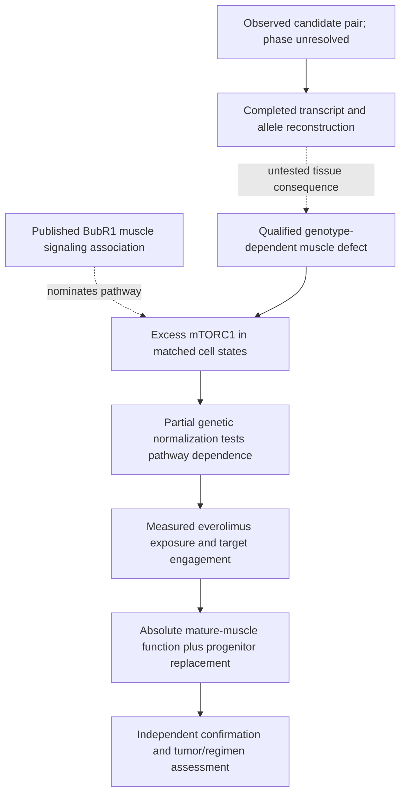

# Evidence pipeline for the elected Track 2 lead

21 September 2026. This is the current prospective pipeline for **everolimus / mTORC1
normalization in BUB1B-associated muscle dysfunction**. It supersedes the lead-drug
and primary-endpoint choices in the dated abundance/NAC protocols, while preserving
their useful general assay principles. [Current proposal](../jeweled_track2_report_submission.md).

## Decision and evidential burden

We elect a drug with a demonstrated molecular action and test whether its target
is harmful in the relevant genotype and tissue. That is a selection judgment.
Human MVA expression-rescue evidence favors the unelected BUBR1-abundance route
at the disease-mechanism level; the missing arimoclomol implementation is why it
does not lead this approved-drug proposal. No quantitative candidate score or
likelihood of clinical benefit has been calculated.

Only the candidate evidence and sequence/population computation are completed for
this project. The remaining nodes are proposed experiments. A missing or failed
link is retained visibly; the arrow diagram does not supply evidence for it.

## Source-to-claim chain

| Evidence | What the source establishes | What it does not establish |
|---|---|---|
| [Track 1 report](../jeweled_track1_report_submission.md) and [sequence reconstruction](../../workflow/track2-model/README.md) | Support for the two nominated alleles and their conditional canonical products. | Observed phase, endogenous protein, a measured mTOR defect or drug response. |
| [Sieben 2020, Fig. 5](https://www.jci.org/articles/view/126863/version/2) | Muscle signaling association in a different heterozygous BubR1 truncation model. RNA sequencing used three mice/genotype; signaling blots used two. | Causal rescue by pathway inhibition, equivalence to L737*/N1002K, or abundance independence. BUBR1 amount and signaling were measured at different ages. [Corrigendum](https://www.jci.org/articles/view/144781) concerns Fig. 2E, not Fig. 5. |
| [Castets 2013](https://pubmed.ncbi.nlm.nih.gov/23602450/) | Rapamycin restored autophagy and improved myopathy in muscle-specific Tsc1-deficient mice. | BUB1B disease rescue or everolimus efficacy. This supports testing pathological excess rather than assuming all pathway activation is beneficial. |
| [Ge 2009](https://pmc.ncbi.nlm.nih.gov/articles/PMC2793064/) and [Bentzinger 2008](https://doi.org/10.1016/j.cmet.2008.10.002) | Interfering with mTOR signaling can impair muscle regeneration; raptor ablation can cause dystrophy. | An inevitable adverse response to carefully limited everolimus exposure in this genotype. They require a stage-specific functional test and argue against complete ablation as a therapeutic proxy. |
| [Fly CIN study, Fig. 6 and supplement](https://doi.org/10.1038/s41467-026-70521-0) | TOR attenuation/rapamycin partially preserved neural stem-cell numbers without restoring progeny or brain size. | BUB1B muscle rescue, everolimus activity or restoration of tissue output. |
| [Everolimus prescribing information, sections 1, 5, 8, 12](https://www.novartis.com/us-en/product/pi/pdf/afinitor.pdf) | Approved uses, drug action, pediatric formulations/experience, monitoring and known risks. | An MVA indication, equivalent culture exposure, absence of growth harm, RMS protection or an appropriate dose for this child. |
| [Population sensitivity results](../../workflow/track2-model/population-results.json) | Under declared assumptions, cell fractions, absolute output and weighted function can disagree; suppressed division creates a compensating-function requirement. | Observed biology, muscle-force simulation, drug effect sizes or a reason to choose everolimus from numerical outcomes. |

## Stage 1 — qualify the genotype and tissue model

Obtain consented material and a laboratory capable of myogenic differentiation
and functional measurement. Access is not secured. Verify genotype and phase when
possible, RNA/splicing, allele-specific expression, BUBR1 amount/localization,
culture identity and baseline chromosome state. Genetic correction, parental and
sham controls distinguish the nominated mechanism from background and editing
effects. Retain independent editing-family/preparation identities.

If patient material is unavailable, label engineered configurations explicitly.
Unknown phase requires testing or retaining both configurations. Cis canonical
translation masks N1002K; it does not establish exactly half-normal functional
dose. Trans sequence reconstruction likewise does not establish protein survival.
The later [BUBR1 pseudokinase-domain study](https://pubmed.ncbi.nlm.nih.gov/33207204/)
also cautions against assuming a surviving truncation is fully functional.

Proceed only with a reproducible muscle-function deficit and interpretable
controls. Failure to generate a mature model is a feasibility failure, not evidence
that the genotype or pathway is harmless. A negative fibroblast result cannot
exclude a muscle-specific defect.

## Stage 2 — distinguish excess signaling from cell-state composition

Compare affected and corrected cultures at matched maturation, density, nutrients
and stimulation. Measure phospho/total p70S6K and 4EBP1, with cell-state-resolved
sampling or validated composition adjustment. A bulk phosphorylation difference
caused by a different mixture of dividing precursors and myotubes is insufficient.
Record baseline function alongside signaling. Orthogonal autophagy-flux or
metabolic measures may test a proposed downstream mechanism; static marker
abundance alone is not flux.

Normal signaling with an otherwise qualified relevant model removes the central
target-selection rationale. A validated excess signal qualifies the causal test;
it does not demonstrate that inhibition will help.

## Stage 3 — test a useful signaling window

Titrate inducible partial RPTOR attenuation toward the corrected-cell range,
using appropriate independent targeting and on-target controls. Complete knockout
is not the intended intervention. Apply the perturbation in affected and corrected
models to detect generic inhibition. Nonlethality is insufficient: cells may survive
while losing proliferation, differentiation or useful function.

Run two separate cohorts:

| Cohort | Prespecified primary functional question | Measurements that prevent misleading improvement |
|---|---|---|
| **Established mature muscle** | Does intervention improve absolute evoked contractile output per construct from the pretreatment cohort? | Baseline and follow-up force, viable tissue/construct size, repeated-stimulation performance and deaths. Area-normalized force is secondary. If only contraction imaging is available, qualify it as a surrogate rather than reporting force. |
| **Progenitors through differentiation/regeneration** | Is viable functional muscle yield per starting cohort preserved or improved? | Absolute progenitor expansion, differentiation/fusion, total viable differentiated yield, later contractile output and abnormal-clone behavior. A higher fusion percentage after losing most cells cannot pass. |

Benefit in the mature cohort accompanied by an unacceptable replacement deficit
fails the joint advancement criterion. The margins defining useful benefit and
acceptable loss require pilot variability and must be fixed before confirmation.
Preservation needs an adequately precise estimate against that margin; a
nonsignificant loss is not evidence of preservation.

If attenuation improves function while normalizing signaling, it supports a
pathogenic contribution of excess activity. If it worsens function, compensatory
signaling or excessive suppression remains possible. Resolve exposure/perturbation
range before concluding that every form of pathway modulation fails.

## Stage 4 — determine whether everolimus implements the useful effect

Compare vehicle with everolimus in affected and corrected models, in each cohort.
Use a pharmacologist-reviewed concentration/time range with measured medium
concentration, stability, binding and cellular engagement. Whole-blood monitoring
targets are not culture-medium free concentrations. High-dose mechanistic controls
cannot satisfy the translational gate. No concentration or patient dose is invented
here before those measurements exist.

Require both pathway engagement and the functional/regenerative result. Partial
RPTOR attenuation and a rapalog have different kinetics and potentially different
effects; one cannot stand in for the other. Genetic success with adequate drug
engagement but no functional benefit rejects the selected drug implementation.
Inadequate exposure or a failed measurement remains inconclusive.

Record spontaneous divisions, absolute clone counts and daughter outcomes in the
progenitor cohort. Retain non-entry, arrest, death, unscorable events and tracking
loss; do not enrich the analysis for surviving/dividing cells. The dated
[founder-ledger specification](founder-ledger.md) supplies endpoint accounting,
not a substitute for muscle-function measurements.

## Stage 5 — confirmation, durability and translation

Randomize and mask within preparation/editing-family blocks. A feasibility pilot
establishes maturation windows, tracking quality, variance and exposure recovery.
Before independent confirmation, freeze primary contrasts, functional-benefit and
regenerative-loss margins, missing-data/exclusion rules and multiplicity policy.
No sample-size claim is possible from cell counts or synthetic runs alone.

Follow established tissue and progenitor output after washout. A transient marker
change or delayed failure does not qualify as durable benefit. Genomic instability
and abnormal-cell expansion remain monitored even if muscle function improves.

Confirm active RMS status and regimen before specifying tumor comparisons. Test
candidate-alone effects and relevant treatment interactions with absolute output
and post-washout regrowth. Everolimus' anticancer indications do not replace this
comparison. Cell assays cannot assess systemic immunosuppression, infection,
growth, renal function or drug interactions; those remain translational review
requirements. The general principles in the dated [oncology appendix](oncology-counterscreen.md)
apply, while its candidate-specific evidence remains historical.

## Decision outputs

| Observation | Decision |
|---|---|
| Model, tissue function or exposure is not interpretable | Unresolved; repair the measurement or report infeasibility. |
| No genotype-associated excess signaling in a qualified muscle model | Deprioritize this target-selection rationale for that model; do not claim all tissues are excluded. |
| Signaling decreases without useful function, or with unacceptable loss of replacement | Do not advance on those results. Distinguish compensatory biology from excessive inhibition. |
| Genetic normalization helps but exposure-qualified everolimus does not | Reject this drug implementation; pathway evidence may remain. |
| Function improves only by selection, at unjustified exposure, or with credible adverse tumor effects | Fail advancement despite attractive marker results. |
| Reproducible function improves, regenerative capacity meets its margin, exposure is justified and parallel results are acceptable | Advance to relevant-model and translational confirmation; no clinical-benefit claim yet. |

The deliverable is a justified, falsifiable research nomination. Unperformed
experiments remain missing evidence, and ambiguous results do not automatically
become a publishable mechanism answer.
