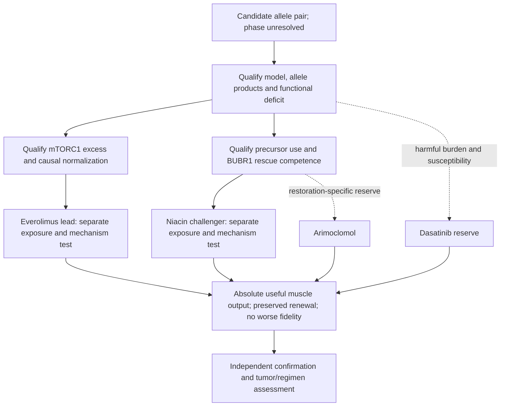

# Evidence pipeline for the Track 2 everolimus–niacin comparison

21 September 2026. The core pair is **everolimus as the narrow submission lead**
and **niacin (nicotinic acid) as the primary orthogonal challenger**, tested
separately, not as a combination. Everolimus represents mTORC1 normalization;
niacin represents restoration of usable BUBR1 through the NAD/SIRT2 hypothesis.
Prioritizing named-drug implementation and pediatric feasibility favors the
everolimus-first presentation; prioritizing the causal restoration question can
favor niacin first. The pair remains the same, and the order is not an efficacy
fact or an automatic inference from genotype.

**Arimoclomol is a restoration-specific reserve; dasatinib is a reserve requiring
harmful senescent burden and selective susceptibility.** Senolysis has the
strongest same-gene organismal functional precedent considered, but its approved
drug implementation remains unresolved. Both core hypotheses require model,
exposure and mechanism qualification; neither waits for the other to fail.
[Current proposal](../jeweled_track2_report_submission.md).

Candidate reconstruction, population sensitivity calculations and a secondary
mouse RNA analysis are completed. No patient-cell, drug-exposure or functional
rescue experiment below has been performed; laboratory access is not secured.
This pipeline supersedes the elected-lead choices in the dated protocols while
retaining their useful assay controls. It supplies no clinical dosing proposal.

## Why this pair, and what remains to be proved

| Source | Established result | Missing bridge or counterevidence |
|---|---|---|
| [Sieben 2020, Fig. 5C](https://www.jci.org/articles/view/126863/version/2) | Increased phosphorylation of p70 S6 kinase and 4EBP1 in gastrocnemius from three-month-old BubR1+/X753 mice; two mice per genotype in the signaling blot. | A different allele and a small pathway-activity observation, not causal or drug rescue. The RNA Hallmark null below does not rebut phosphorylation. |
| [Choi 2016](https://pmc.ncbi.nlm.nih.gov/articles/PMC5560052/); [Choi 2019](https://www.nature.com/articles/s41467-019-09318-3) | BUBR1 participates in insulin-receptor (IR) endocytosis; its depletion delays uptake in cultured cells. Hypomorphic mice have increased insulin sensitivity. | No N1002K-to-myogenic-mTORC1 demonstration. The 2019 SHP2 intervention prolonged liver AKT signaling, but not muscle AKT; that intervention is distinct from BUBR1 deficiency. |
| [Everolimus label](https://dailymed.nlm.nih.gov/dailymed/fda/fdaDrugXsl.cfm?setid=2150f73a-179b-4afc-b8ce-67c85cc72f04) | Established mTOR inhibition and pediatric approved-use experience in specified TSC indications support a concrete drug implementation. | Neither establishes harmful mTORC1 excess, a useful exposure window or functional benefit in BUB1B-associated disease. |
| [Suijkerbuijk 2010](https://pubmed.ncbi.nlm.nih.gov/20516114/) | Selected human MVA BUBR1 mutants have abundance defects; forced expression can restore a checkpoint response. | N1002K was not tested. HSP90 dependence does not demonstrate arimoclomol/HSP70 rescue, and a nocodazole response does not establish spontaneous segregation fidelity. |
| [North 2014, Figs. 4–6](https://pmc.ncbi.nlm.nih.gov/articles/PMC4194088/) | NMN increased BUBR1 abundance in WT MEFs, largely through SIRT2, and in aged WT mouse testes. Genetic SIRT2 overexpression improved selected cardiac outcomes and male survival in BubR1 hypomorphs. | The drug experiments used 1 mM NMN for 24 hours in cells and 500 mg/kg/day intraperitoneally for seven days in mice. NMN did not supply the genetic survival result. WT/hypomorphic protein is not N1002K; small size, cataracts and lordokyphosis were not reversed by SIRT2 overexpression. |
| [Pirinen 2020](https://pubmed.ncbi.nlm.nih.gov/32386566/) | In a nonrandomized open-label study of five mitochondrial-myopathy patients and ten controls, niacin increased NAD, including patient muscle NAD; strength also increased. | Different disease, small uncontrolled study, no BUBR1 measurement. The slow-release preparation and adult study exposure cannot be assumed equivalent to every prescription formulation or to a child's exposure. |
| [Membrez 2024](https://pmc.ncbi.nlm.nih.gov/articles/PMC10963276/) | Human-myotube NA/NAPRT experiments provide a direct-utilization precedent; exact results below. | No BUBR1, mutant-function or clinical-exposure result. |
| [Aaltio 2024](https://pubmed.ncbi.nlm.nih.gov/39173541/) | A child with MTTN myopathy had metabolic improvement after niacin corrected NAD deficiency. | Disease progressed with meager clinical response: NAD normalization alone is not useful tissue rescue. |
| [Niacin ER label, revised February 2026](https://dailymed.nlm.nih.gov/dailymed/fda/fdaDrugXsl.cfm?setid=dd60fe81-3d54-4a29-9502-601be89c575e) | Nicotinic-acid products have approved lipid-related uses. | Pediatric safety, effectiveness and pharmacokinetics are unestablished in this label. Formulation, liver, muscle and metabolic effects require review; approval does not establish an MVA indication. |
| [Arimoclomol studies: Gaucher 2018](https://doi.org/10.1016/j.ebiom.2018.11.037), [NPC 2025](https://doi.org/10.1016/j.ymgme.2025.109103) | Mutant lysosomal-protein processing/function and stress-response pathways can improve in the tested settings. | Neither demonstrates BUBR1 rescue. High nominal concentrations and different protein compartments limit transfer; see the [exposure review](mechanistic-bridge.md). |
| [MIPLYFFA label, March 2026](https://dailymed.nlm.nih.gov/dailymed/lookup.cfm?setid=5feffc0e-453d-47fa-91dd-38d4952309bc&version=5) | Arimoclomol with miglustat has an NPC indication from age two; estimated pediatric mean serum peak is 523 ng/mL, approximately 1.67 micromolar. | Its clinical mechanism in NPC remains unknown. Pediatric use elsewhere does not establish exposure-qualified BUBR1 rescue. |
| [Baker 2011](https://pmc.ncbi.nlm.nih.gov/articles/PMC3468323/) | INK-ATTAC-mediated clearance of p16-positive cells improved selected tissue and exercise outcomes in BubR1 hypomorphs. | Genetic selective clearance does not validate dasatinib or D+Q selectivity or functional rescue in this genotype. |

Niacin's challenger role preserves this testable restoration evidence chain;
it does not claim measured inferiority to everolimus. **NMN is a mechanistic
reference, not an approved-drug nomination**;
dietary-ingredient status is not drug approval. Niacin, nicotinamide/niacinamide,
NMN and genetic SIRT2 elevation are distinct interventions. North's high-dose
nicotinamide experiment reduced BUBR1, so vitamin-family naming cannot determine
the direction of effect. [BUBR1 K250 experiments](https://doi.org/10.1016/j.bbrc.2014.09.128)
also separate SIRT2-dependent acetylation, total protein and checkpoint behavior.

## 1. Qualify the allele products and model

Verify genotype/phase where possible, RNA/splicing, allele-specific expression,
full-length versus truncated BUBR1, localization and baseline chromosome state.
Use affected, genetically corrected, parental cell line and sham controls, retaining
independent editing-family and preparation identities. Relevant myogenic models
must have a reproducible functional deficit before a muscle-rescue claim is tested.
Failure to generate a mature model is a feasibility failure; a negative fibroblast
result cannot exclude a muscle-specific defect.

If using engineered models, label them explicitly and retain both phase
configurations until resolved. In cis, canonical translation from the stop-bearing
allele masks downstream N1002K; the other allele can supply WT protein. This does
not establish half-normal functional dose. In trans, the missense allele can supply
full-length protein, but its abundance/function and the stop allele's RNA/protein
survival remain unmeasured. [Sequence reconstruction](../../workflow/track2-model/README.md)
is conditional; [pseudokinase-domain evidence](https://pubmed.ncbi.nlm.nih.gov/33207204/)
precludes assuming a surviving truncation is fully functional.

## 2. Qualify both mechanism hypotheses alongside each other

Genotype does not establish mTORC1 excess, NAD limitation or treatment response.
Qualify the relevant mechanism in the same model before interpreting its drug
test; failed models or assays are not candidate exclusions.

### Everolimus and mTORC1 normalization

Qualify this core hypothesis alongside restoration by testing
for genotype-associated excess signaling at matched maturation, density,
nutrients and cell composition; restoration failure is not a prerequisite.
Measure phospho/total p70S6K and 4EBP1 and, where relevant, autophagy flux. The
[Sieben muscle association](https://www.jci.org/articles/view/126863/version/2)
includes increased p70 S6 kinase and 4EBP1 phosphorylation in three-month-old
BubR1+/X753 gastrocnemius (two mice per genotype in the signaling blot), but
does not establish causal rescue. Our [GSE134781 analysis](../../workflow/track2-rna/README.md)
found no positive mTORC1 Hallmark corroboration (X753–WT P=0.219; global FDR=0.983).
This is not evidence against the measured phosphorylation: transcription and
kinase activity are different endpoints.

Retain adverse evidence: [Baker 2013](https://pmc.ncbi.nlm.nih.gov/articles/PMC3785294/)
reports preliminary unpublished observations of similar age-phenotype development
in rapamycin-fed and control BubR1 progeroid mice; this is not a fully reported
negative trial. [Goutas 2023, Fig. 6](https://pmc.ncbi.nlm.nih.gov/articles/PMC10149375/)
found that 50 nM everolimus for 24 hours reduced BUBR1 in late-passage WJ-MSCs,
with no corresponding early-passage reduction. This is a cell-state-specific
warning, not a mutant experiment or proof of harm in MVA. These concerns justify
monitoring and decision criteria; they do not establish arimoclomol superiority.
Normal signaling, failure of function despite target engagement, or loss of
BUBR1/renewal would move everolimus down. Functional rescue at justified exposure
would support advancement; compare absolute output rather than biomarker change alone.

If excess signaling is qualified, titrate partial inducible RPTOR attenuation
toward the corrected-cell range with independent targeting/on-target controls.
Complete knockout is not the intended intervention. Test both functional cohorts;
genetic success must then be implemented separately by exposure-qualified
everolimus, with sirolimus as the actual rapamycin reference compound.

Compare continuous exposure with finite pulses followed by verified washout over
the same observation period. Match handling, record cumulative exposure and state
whether the contrast tests a whole regimen or timing at comparable exposure.
Measure drug disappearance, signaling recovery/rebound, BUBR1, function and reserve;
washout alone is not recovery. No pulse schedule is presumed protective.
[Tsc1 myopathy rescue](https://pubmed.ncbi.nlm.nih.gov/23602450/), opposing regeneration
contexts ([Ge 2009](https://pmc.ncbi.nlm.nih.gov/articles/PMC2793064/),
[Balnis 2025](https://doi.org/10.1172/jci.insight.182842)), and the
[negative older-adult functional trial](https://doi.org/10.1002/jcsm.70274)
justify testing the window rather than declaring benefit from pathway inhibition.

#### Conditional follow-up: insulin-receptor trafficking

If the matched affected/corrected comparison establishes mTORC1 excess, use the
same preparations to test whether altered IR trafficking supplies an upstream
explanation. This is a prospective mechanistic branch, not another medication
nomination or an experiment required before submission. The Choi studies above
motivate it, but their cell-line/liver evidence does not establish this mechanism
in affected muscle. C-terminal interaction mapping is not a functional assay of
N1002K or the actual truncation.

The [Sieben discussion](https://www.jci.org/articles/view/126863/version/2)
already proposed this upstream connection; it remains a hypothesis. Its different
muscle-signaling outcomes across alleles also oppose a universal inference from
low BUBR1. [Park 2023](https://pubmed.ncbi.nlm.nih.gov/37725942/) genetically
disrupted IR–MAD2 binding and found delayed endocytosis/prolonged surface signaling,
but also impaired insulin clearance and altered circulating hormones. This extends
the trafficking evidence without establishing harmful myogenic mTORC1 activation;
isolated cells will not model those systemic feedbacks.

1. **Resolve uptake and signal duration together.** Compare affected and isogenic
   corrected cells, retaining independent editing/preparation controls. Analyze
   progenitors and differentiated myotubes separately at matched density,
   maturation and nutrients. Under defined insulin stimulation and withdrawal,
   follow endogenous surface-labeled IR into the cell with a validated uptake
   assay, expressing uptake relative to the starting labeled surface pool.
   Measure recycling and total/surface receptor abundance separately;
   a surface-to-intracellular ratio alone cannot distinguish these processes.
   Verify that labeling does not change signaling. In matched samples measure
   phospho/total IR, AKT-T308 and ERK alongside p70S6K and 4EBP1 across activation
   and decay; record AKT-S473 separately if measured, not as an mTORC1 endpoint.
   Fix the insulin exposure, sampling window and duration/AUC comparisons
   after the pilot; a larger peak alone does not show prolonged signaling.
2. **Test the proposed connection.** Control insulin/IGF content and distinguish
   INSR from IGF1R engagement; receptor identity cannot be inferred from AKT alone.
   If delayed uptake and prolonged mTORC1 signaling co-occur, test partial,
   inducible INSR attenuation with on-target controls, titrated toward corrected
   signaling rather than removal of basal trophic support. This tests receptor
   dependence, not whether delayed uptake itself mediates the effect. Genetic
   correction also affects mitosis and need not erase prior karyotypic differences;
   document those differences and do not interpret coincident rescue as isolation
   of a direct nonmitotic mechanism. A trafficking-specific causal claim requires a
   qualified separation-of-function perturbation; do not assume one is available
   for these alleles.
3. **Establish whether the excess is harmful.** Retain the existing partial RPTOR
   test and absolute-function, renewal and fidelity criteria. Improved insulin
   responsiveness may be neutral or helpful. AKT elevation without mTORC1 excess,
   or marker normalization without functional gain, cannot justify everolimus.
   Cells and images remain nested observations under the existing replication
   plan; this exploratory branch does not enlarge the four confirmatory drug
   claims.

| Focused result | Interpretation |
|---|---|
| Delayed IR uptake and prolonged downstream activity reverse with correction; INSR dependence and beneficial partial RPTOR normalization are supported | Supports an IR-linked mTORC1 explanation; trafficking mediation and variant-specific action still require their own evidence. |
| IR kinetics are normal within a prespecified detectable effect, or an IR alteration does not track mTORC1 activity | Deprioritize this trafficking explanation in the tested state. A different cause of mTORC1 excess remains possible. |
| Longer signaling accompanies preserved or improved function, or its reduction impairs output/renewal | Do not label that response harmful or use it to favor pathway suppression. |

### Niacin and the restoration-specific arimoclomol reserve

Separate rescue of quantity from rescue of quality.

Titrate WT, N1002K and the actual 1–736 truncation in defined allele backgrounds
across measured physiological protein amounts,
using comparable expression systems and controls for localization, cell state,
arrest and viability. Rescue must include spontaneous chromosome segregation and
productive progenitor output; checkpoint challenge is an additional readout.
Measure protein turnover and function at matched abundance rather than treating
a stronger band as a corrected allele. Determine whether the truncated product
helps, is inert or interferes; expression constructs may bypass endogenous NMD.

If additional N1002K restores function, an abundance-limited route earns support.
If expression-matched N1002K remains defective, quantity stabilization alone loses
priority. That failure **does not exclude chaperone-mediated improvement of folding
or function per molecule**; arimoclomol would then need to demonstrate that distinct
effect. If neither WT correction nor a qualified WT rescue restores the phenotype,
resolve the model/background before assigning drug failure to this mechanism.

For niacin, measure baseline and drug-induced intracellular NAD, SIRT2 expression
and a validated activity readout, then BUBR1 turnover and tissue function. NAD
deficiency is an unknown to measure, not a mandatory inclusion criterion. Compare
a suitable SIRT2 perturbation with its rescue or catalytically inactive control; account for effects on baseline BUBR1, viability
and cell cycle. NMN provides a pathway reference, not an interchangeable exposure.
For arimoclomol, distinguish inducible/constitutive HSP70-family responses and
HSP90-related effects from BUBR1 amount, localization and function. Neither a
chaperone marker nor correlation between NAD and BUBR1 proves causal rescue.
SIRT2 dependence alone does not establish BUBR1 dependence: SIRT2 has other
substrates. N1002K-specific SIRT2 interaction is unmeasured; neither preserved
nor disrupted binding follows from its sequence position. To claim the full chain, use an interpretable BUBR1 abundance clamp
or orthogonal perturbation, with titration that preserves baseline function and
NAD engagement. Severe depletion that destroys the baseline cannot answer this
question. If that causal test is infeasible, retain functional benefit as an
observation without claiming that the restoration mechanism is established.

### Qualify niacin utilization

Published NAD responses relative to each control:

| Panel / source data | Exposure and result | Interpretation |
|---|---|---|
| [Extended Fig. 1f, rows 77–90](https://media.springernature.com/full/springer-static/esm/art%3A10.1038%2Fs42255-024-00997-x/MediaObjects/42255_2024_997_MOESM6_ESM.xlsx) | NA 1 mM/24 h: 127.47%; Šídák-adjusted P=0.454; n=6. | Nonsignificant multi-precursor comparison. |
| [Extended Fig. 2e, rows 175–189](https://media.springernature.com/full/springer-static/esm/art%3A10.1038%2Fs42255-024-00997-x/MediaObjects/42255_2024_997_MOESM7_ESM.xlsx) | Scrambled-shRNA + NA: 131.15%, P=0.0017; NAPRT-shRNA + NA: 107.55%, P=0.1278; n=6/group; 24 h. | Within-group tests; NA concentration not restated; no FK866 indicated. |

Similar effect estimates need not contradict each other when statistical tests
differ. The second panel reports no interaction test. Replicates are not established
as independent donors. Do not transfer trigonelline's functional results to NA.

Measure NAPRT and downstream precursor-processing capacity in the actual human
progenitor and differentiated cultures, together with baseline medium/serum
nicotinic acid and nicotinamide content. Expression alone is insufficient: establish
concentration/time-dependent precursor utilization and NAD response with a qualified
assay, retaining isotope tracing as an orthogonal option where available. Do not
create an artificial deficiency solely to produce an attractive rescue result;
any induced-deficiency control stays separate from the genotype comparison.

Use the Membrez experiment as a mechanistic positive precedent, not as the selected
exposure. The NAPRT-poor C2C12 negative is a warning about model choice. Confirm the
relevant activities in both muscle-supporting progenitors and mature myotubes;
results in differentiated human cells cannot be assumed to apply to every progenitor state.
If NAD fails to respond despite measured exposure, distinguish absent utilization
from a defective downstream SIRT2/BUBR1 link. NMN/NR reference responses cannot
rescue a failed nicotinic-acid implementation by substitution.

[Mouse isotope tracing](https://pmc.ncbi.nlm.nih.gov/articles/PMC5932087/)
demonstrates that tissue NAD supply can depend on circulating metabolites and
route of administration. Thus a parent-drug-only culture failure does not by itself
exclude a systemic precursor mechanism. Testing that alternative requires measured
metabolite exposure and an appropriate model; hypothesized liver or microbiome
conversion cannot excuse an unresponsive assay or be counted as niacin success.
The NMN, NAM and nicotinic-acid routes are not interchangeable. In particular,
North's high-dose nicotinamide inhibition does not establish that lower-dose
nicotinamide can never raise NAD; any alternative needs its own drug and functional
case instead of inheriting niacin's nomination.

## 3. Compare exposure-qualified drug implementations

Test vehicle, everolimus and niacin in separate treatment arms in affected and
corrected cultures, with the relevant genetic controls above. This is not an
everolimus–niacin combination proposal. Test arimoclomol or dasatinib separately
if their reserve hypotheses are qualified. Use pharmacologist-reviewed concentration/time
ranges and measure medium concentration, stability, binding and relevant cellular
engagement. Clinical total serum or blood concentrations are not culture-medium
free concentrations. Match handling and observation periods; compare justified
exposure and engagement rather than equal nominal concentrations between drugs.

Duration must be sufficient for each proposed mechanism before a negative response
is called interpretable. High-exposure mechanistic controls can inform biology but
cannot pass the repurposing gate. Record formulation and active analyte; a clinical
niacin dose, an NMN mouse injection and a culture concentration are not equivalents.
Target engagement without functional benefit rejects that implementation only
within the qualified exposure, duration, tissue and genotype tested.

## 4. Require useful output in two separate functional cohorts

| Cohort | Primary question | Required accounting |
|---|---|---|
| **Progenitors through differentiation/replacement** | Does treatment improve absolute functional muscle yield per starting cohort while preserving renewal and not worsening chromosome fidelity in dividing populations? | Track founders, non-entry, completed divisions, daughter outcomes, arrest, death, tracking loss, clone expansion, differentiation and total viable muscle output. Measure later absolute contractile output; a higher fusion percentage after cell loss cannot pass. |
| **Established mature muscle** | Does treatment improve absolute evoked contractile output per construct from the pretreatment cohort? | Record baseline/follow-up force, viable tissue size, repeated-stimulation performance and deaths. Area-normalized force is secondary; contraction imaging is a surrogate if force is unavailable. |

The common advancement criterion is useful absolute muscle output with preserved
renewal and no worse chromosome fidelity against the prespecified comparison.
**Either cohort may supply the meaningful functional benefit, while output in the
other cohort, renewable progenitor reserve and fidelity must meet their preservation
margins.** Both cohorts need not improve. This symmetric rule allows mature-muscle
benefit without greater replacement, or greater progenitor-derived output without
greater established-muscle force; it does not allow one benefit to cancel harm
elsewhere. Cohort outputs remain separate rather than being pooled into a score.
Freeze useful-benefit and acceptable-loss boundaries prospectively; a nonsignificant
difference is not proof of preservation. A claim of BUBR1 restoration additionally
requires relevant BUBR1-dependent functional and fidelity evidence. Downstream
mTORC1 benefit need not correct the existing mitotic defect, provided it meets the
common functional and preservation criteria. Conditional senolysis likewise must
show that selective clearance improves net function while preserving replacement;
it need not correct segregation in surviving cells. Report each mechanism claim
separately from the common functional result.

Use the [founder ledger](founder-ledger.md) to retain the starting denominator and
unscorable outcomes; do not analyze only surviving or dividing cells. Record both
error rate per completed division and total lineage output, because slower division
can improve a fraction while reducing replacement. Orthogonal chromosome-state
measurements distinguish new fidelity from selection of pre-existing clones.
The [population sensitivity calculations](../../workflow/track2-model/population-results.json)
illustrate this distinction; they are not observed drug effects or force predictions.

Mature-tissue benefit with unacceptable replacement loss fails advancement.
Follow function, growth and chromosome instability after withdrawal where feasible;
a transient marker change or delayed collapse is insufficient. An interpretable
benefit in one cohort cannot be silently generalized to the other.

## 5. Conditional reserves

A [BubR1-knockdown C2C12 study](https://pmc.ncbi.nlm.nih.gov/articles/PMC5023544/)
reported impaired myogenic differentiation/fusion. Its SA-β-gal assays were negative
at earlier population doublings than the fusion experiment; these are not paired
proof of senescence-independent dysfunction, and one marker does not exclude
senescence. The study tested no drug. It supports measuring the myogenic defect
and harmful senescent burden separately instead of assigning every BUB1B defect
to a senolytic-responsive population.

**Senolysis:** qualify harmful senescent-cell burden alongside restoration tests;
this route need not wait for restoration to fail. Dasatinib monotherapy is a
conditional reserve: [fat-cell progenitor activity](https://pubmed.ncbi.nlm.nih.gov/25754370/)
does not establish selective susceptibility or function in muscle-supporting cells.
Arimoclomol is the restoration-specific reserve, without demonstrated superiority
to dasatinib. In fibro-adipogenic
progenitor/myogenic cocultures, use a selective-clearance reference and track both
populations, replacement and absolute muscle output to distinguish useful removal
from nonspecific killing. A lower senescence-marker fraction cannot pass alone.

The [same-model D+Q patent evidence](https://patents.google.com/patent/WO2015116735A1/en)
is marker-level evidence, not functional rescue or dasatinib-alone efficacy.
The [competition rules](https://huggingface.co/spaces/SageBio/rare-disease-real-kid-mva-hackathon-2026/blob/main/tabs/about.py)
do not expressly require an approved regimen; D+Q eligibility
is unresolved because quercetin lacks an established approved-drug status here.
Retain D+Q as an experimental comparator, not a clearly eligible nomination.

## 6. Confirmation and decision outputs

Randomize and mask within preparation/editing-family blocks. Pilot data establish
tracking quality, variance, exposure duration and recovery. Before independent
confirmation, freeze primary contrasts, useful-benefit and acceptable-loss margins,
missing-data/exclusion rules and multiplicity policy. Biological preparations are
replicates; cells and repeated images are nested observations. Require uncertainty
intervals to meet the benefit/preservation margins; nonsignificant harm is not
evidence of preserved reserve. Cell counts or simulations cannot set sample size.

### Confirmatory benefit rule

For one qualified genotype/model, freeze one exposure regimen per drug and one
primary endpoint/time per functional cohort before independent confirmation.
The four possible claims are everolimus or niacin benefit in progenitor-derived
output or established-muscle output. Each claim jointly requires improvement
beyond the chosen useful-benefit margin and preservation of the other cohort,
renewable progenitor reserve and chromosome fidelity. The latter comparisons use
predeclared acceptable-loss margins, not a failure to detect harm.

Use valid one-sided component tests at the independent preparation/editing-family
level, retaining pairing and nesting. For a joint claim, take the largest component
P value (the intersection–union rule: every required component must pass). Apply
Holm's step-down correction across the four joint-claim P values at family-wise
alpha 0.05. This controls false advancement opportunities without requiring an
arbitrary advantage for one mechanism. Report component effect estimates and
intervals with their adjustment status; the rule does not confer simultaneous
coverage on every displayed interval. [Endpoint logic and Holm procedure](https://www.fda.gov/media/162416/download),
[intersection–union methodology](https://doi.org/10.1016/j.jspi.2007.03.021).

Passing for one drug and not the other is not proof of a between-drug difference;
a superiority claim needs its own prespecified direct comparison.

Pilot observations select assay times, margins, exposure and an attainable
independent replication plan; they do not also serve as confirmatory evidence.
Retain an untested or uninterpretable claim as nonpassing in the four-claim family
rather than dropping it to ease the threshold. Additional confirmatory doses,
schedules, genotypes or endpoint times require an expanded prespecified family or
a separate independent study. Mechanistic attribution and tumor compatibility
remain separate required assessments; a functional claim supplies neither by
itself. These are prospective ex-vivo analysis choices, not clinical-trial results
or a claim of regulatory endorsement.

### Rhabdomyosarcoma evidence and treatment compatibility

The recorded RMS history makes oncology compatibility part of the proposed test.
The clinical literature contains both mTOR-class trials and direct everolimus
reports; they answer different questions and cannot be pooled into an assumed
anticancer benefit for this child.

| Primary clinical evidence | Finding | Consequence for this proposal |
|---|---|---|
| [ARST0921, first relapse/progression RMS](https://pmc.ncbi.nlm.nih.gov/articles/PMC6823886/) | Temsirolimus or bevacizumab, each with vinorelbine/cyclophosphamide: reported six-month event-free survival 69.1% versus 54.6%; final EFS comparison P=.018. No significant overall-survival difference. | Favors the temsirolimus-containing regimen over that comparator. No chemotherapy-only arm and no everolimus arm; it does not establish everolimus benefit. |
| [ARST1431, newly diagnosed intermediate-risk RMS](https://pubmed.ncbi.nlm.nih.gov/38936378/) | 297 evaluable participants; three-year EFS 66.8% with temsirolimus versus 64.8% without; HR 0.86 (95% CI 0.58–1.26), P=.44. Both groups received VAC/VI and maintenance treatment. | Adding temsirolimus did not demonstrate EFS improvement. The setting and comparator differ from ARST0921; mTOR inhibition is not a general guarantee of RMS benefit. |
| [ADVL1711, recurrent/refractory RMS](https://pubmed.ncbi.nlm.nih.gov/40313040/) | Single-arm lenvatinib plus everolimus: 2/20 partial responses (10%; 95% CI 1.2–31.7), lasting 2.10 and 2.76 months; did not meet the prespecified activity threshold. | Direct everolimus-containing clinical evidence exists, with limited activity. Neither response nor toxicity can be attributed to everolimus alone. |
| [Epelman, SIOP 2015 abstract O-052](https://siop-online.org/wp-content/uploads/2015/10/SIOP-2015-Abstracts-Nov-2.compressed.pdf#page=100) | Everolimus monotherapy: six RMS among 17 heavily pretreated sarcoma patients; one RMS partial response reportedly lasted 11 months. | A small direct signal, but abstract-only, without a comparator or complete RMS-specific outcomes. It supplies neither reliable efficacy nor survival evidence. |

None of these studies establishes benefit in BUB1B-associated MVA, and muscle
mTORC1 activation does not establish tumor dependence. The muscle hypothesis and
oncology compatibility therefore remain separate questions.

Confirm current tumor status, subtype/fusion status and the actual oncology
regimen before choosing tumor models and treatment comparators. For **each nominated
drug separately**, compare vehicle, candidate, confirmed oncology treatment and
candidate plus that treatment. Retain absolute viable tumor output and
post-withdrawal regrowth; early cytostasis is not durable tumor control. A
nonresponsive treatment control cannot establish compatibility. Prespecify an
acceptable tumor-protection margin and judge its uncertainty interval, rather
than interpreting nonsignificance as absence of interference. The [dated oncology
framework](oncology-counterscreen.md) supplies these general design principles;
its historical arimoclomol/NAC ranking does not govern the current candidates.

The [everolimus label](https://dailymed.nlm.nih.gov/dailymed/fda/fdaDrugXsl.cfm?setid=2150f73a-179b-4afc-b8ce-67c85cc72f04)
also makes radiation history, wound healing and actual interacting medicines
relevant to translational review. Recorded failure to thrive and muscle atrophy
make growth/renewal loss a decisive functional failure; recorded nephrocalcinosis
does not establish measured renal impairment. These clinical-context gaps cannot
be resolved by a tumor culture. Systemic growth, renal, hepatic, immune and
interaction effects remain outside cell-assay inference. No treatment schedule
or patient dose is inferred from the trials or labels.

### Decision outputs

| Observation | Decision |
|---|---|
| Model, precursor utilization, mechanism engagement, exposure, duration or functional measurement is inadequate | Uninterpretable nonresponse; repair the limitation or report infeasibility. |
| Qualified assays find no genotype-associated harmful mTORC1 excess | Deprioritize the proposed everolimus normalization mechanism in that model; neither genotype nor an unrelated pathway marker can substitute for the missing premise. |
| Additional N1002K quantity fails at matched physiological abundance | Deprioritize quantity-only rescue in that model; folding/function-per-molecule rescue remains a separate hypothesis. |
| Genetic/mechanistic rescue works but an adequately engaged drug does not improve function | Target success, drug-implementation failure; do not discard the target or award the drug genetic efficacy. |
| NAD, BUBR1 or pathway markers improve without functional benefit | Do not advance on markers alone. |
| Function improves without established BUBR1 dependence | For niacin/arimoclomol, retain the observation without claiming restoration. For everolimus, independently supported mTORC1-mediated benefit can advance without correcting the pre-existing mitotic defect if common functional, renewal and fidelity criteria are met. |
| Favorable fractions arise only from selective loss without improved useful absolute output, or benefit requires unjustified exposure, unacceptable renewal loss, worse chromosome fidelity or credible adverse tumor effects | Fail advancement despite favorable fractions or signaling. |
| A qualified experiment excludes a useful effect with adequate precision | Resolved negative only for the tested implementation, tissue, genotype, exposure and duration. |
| Independent experiments meet absolute functional-benefit, renewal-preservation, no-worse-fidelity and exposure criteria with acceptable parallel results | Advance that implementation to relevant-model/translational confirmation; state only the mechanism supported by the data, with no clinical-benefit claim yet. |

The submission is a focused comparison of everolimus-mediated mTORC1 normalization
and niacin-mediated BUBR1 restoration, tested separately, with arimoclomol and
dasatinib retained for their qualified reserve roles. The narrow everolimus-first
submission order is a prioritization judgment, not a functional superiority claim.
Neither incomplete experiments nor ambiguous results close an evidence gap.
