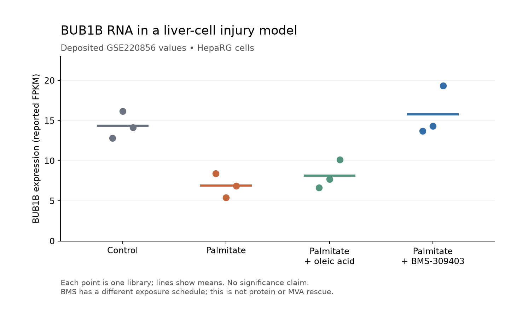

# Lipid remodeling: a BUB1B transcript signal worth following

**23 September 2026.** Retain **BMS-309403 as a mechanistic RNA research
reserve**, and oleic acid/EPA as lipid-remodeling comparators. The administered
compounds have measured effects in a human liver-cell injury model. They do not
yet displace provisional niacin/restoration or apitegromab/compensation: protein,
chromosome fidelity and relevant-genotype benefit remain unmeasured for this
route, and the initiating injury differs from BUB1B-associated MVA.

[Jia et al., Science Advances 2023](https://doi.org/10.1126/sciadv.abq2937)
(PMID 36638165; PMC9839333) combine human liver tissue observations, a mouse
fibrosis model, and HepaRG cell experiments. The tested rescue compounds were
administered to cultured cells. The human samples and mouse fibrosis series
are not drug-treatment trials.

## Actual interventions and results

| Material and role | What was tested | What can be credited |
|---|---|---|
| **Deuterium-labeled palmitate, PA-d31: injury substrate** | 400 µM, 4 h in HepaRG; isotope labeling tracks newly synthesized lipid. | More ordered, less fluid membranes; altered lipid storage and a stress/cell-cycle transcript response. BUB1B RNA is lower in Figure 6C. This is an injury model, not a treatment benefit or evidence about ordinary dietary exposure. |
| **Oleic acid, OA: cotreatment** | 200 µM with PA for 4 h. | Membrane order decreases and triglyceride storage/unsaturation increase. Some injury-associated transcripts change. The deposited BUB1B mean is modestly higher than PA alone, still well below control. |
| **Eicosapentaenoic acid, EPA: cotreatment** | 50 µM with PA for 4 h. | Membrane/lipid measurements improve. There is no EPA RNA group in the deposited series, so EPA must not inherit OA or BMS gene-expression results. Free EPA is not automatically equivalent to an ethyl-ester medicine or a fish-oil mixture. |
| **BMS-309403: pharmacological probe** | 50 µM for 24 h with concomitant PA for 4 h. | Membrane/lipid measurements improve. The deposited BUB1B RNA mean returns near the control mean. BMS alone has no reported effect on triglyceride accumulation or membrane order in Figure S16; there is no BMS-alone RNA group. |

The favorable membrane measurements are real physical readouts. “Cell rescue”
needs a narrower interpretation: Figure 7's additional evidence is largely
transcriptomic, including lower CASP2 after OA. Lower expression of an
apoptosis-associated gene does not directly measure fewer dead cells, restored
clonogenic output, repaired chromosome segregation or improved organ function.
The reviewed rescue panels do not supply those functional endpoints.

## Direct extraction of the public BUB1B data

We extracted the exact **ENSG00000156970 / BUB1B** row from the deposited
[GSE220856 matrix](https://ftp.ncbi.nlm.nih.gov/geo/series/GSE220nnn/GSE220856/suppl/GSE220856_gene_fpkm.txt.gz)
and verified all twelve sample labels against its
[SOFT metadata](https://ftp.ncbi.nlm.nih.gov/geo/series/GSE220nnn/GSE220856/soft/GSE220856_family.soft.gz).
The BUB1B-PAK6 readthrough row is excluded. These are our descriptive
calculations from the published values, not a new experiment.

| Condition | Deposited values, replicates 1/2/3 | Mean ± sample SD | Mean / PA mean |
|---|---|---:|---:|
| Control | 12.797 / 16.157 / 14.159 | 14.371 ± 1.690 | 2.086 |
| PA | 8.395 / 5.403 / 6.870 | 6.889 ± 1.496 | 1.000 |
| PA + OA | 6.632 / 7.724 / 10.112 | 8.156 ± 1.780 | 1.184 |
| PA + BMS | 13.686 / 14.303 / 19.331 | 15.773 ± 3.096 | 2.290 |



The file and processing description use FPKM; one GEO supplementary-format
sentence instead says RPKM. We preserve that inconsistency. All three libraries
per condition are retained, including the separated BMS3 sample visible in
the source's PCA. Replicates are not independent human donors. BMS has a
different exposure schedule from the PA/OA arms, and a time-matched
vehicle/BMS-alone RNA comparison is not supplied here.

**No gene-specific rescue P value or adjusted P value is established by this
extraction.** Figure 6 displays BUB1B in the PA-injury heatmap; Figure 7's
rescue heatmaps omit it. Methods state an adjusted-P criterion while Figure
S18 labels its volcano threshold as P/pvalue without the adjustment wording.
The public processed matrix supplies expression values, not raw counts or a
gene-level differential-expression table. We do not reconstruct counts from
FPKM or claim to reproduce the original statistical analysis.

The standard-library [extraction script](summarize_lipid_bub1b.py) reproduces
the [twelve values and summaries](lipid-bub1b-expression.json) from the two
hash-checked source files. Plotting additionally requires matplotlib:

```sh
python3 workflow/track2-drug-census/summarize_lipid_bub1b.py \
  --matrix /path/GSE220856_gene_fpkm.txt.gz \
  --soft /path/GSE220856_family.soft.gz \
  --output /path/bub1b-summary.json
```

## Target attribution and competitiveness

BMS-309403 is principally characterized as a **FABP4/aP2 inhibitor**. The
inspected primary pharmacology passage reports ANS-displacement Ki values
below 2 nM for FABP4, 250 nM for FABP3 and 350 nM for FABP5; it supplies no
FABP1 affinity. Those biochemical values are not cellular IC50s. The liver
paper shows FABP1 upregulation in separate tissue, but neither that observation
nor broad FABP inhibition proves BMS–FABP1 engagement or a FABP1-dependent
HepaRG response at 50 µM. The original pharmacology has positive FABP4 genetic
dependency controls in other models; those are not FABP1 controls here.
[Primary pharmacology](https://pmc.ncbi.nlm.nih.gov/articles/PMC4076119/),
[official compound identity](https://cdn.caymanchem.com/cdn/insert/10010206.pdf).

The BMS signal merits follow-up because an actual compound accompanies a
directional BUB1B RNA recovery, alongside physical membrane effects. It remains
weaker than the evidence required to select a restoration lead: no BUBR1
protein, checkpoint or daughter-cell fidelity result; no Leu737Ter/Asn1002Lys
model; no muscle output; unresolved cellular target attribution and exposure
translation. Global cell-state changes could explain the transcript response.
OA's smaller BUB1B change and EPA's absent RNA arm provide still less support
for a protein-restoration claim. Neither food availability nor an adjacent
approved formulation closes these gaps.

Compared on equal terms, BMS has an actual-compound BUB1B transcript observation
in the reviewed data; niacin's proposed BUBR1 bridge still depends on experiments
with another NAD precursor or genetic SIRT2 elevation. Niacin instead has
separate human muscle NAD target engagement and a medicine/exposure context.
Neither supplies functional rescue of this genotype. Thus BMS is a credible
mechanistic challenger, with no demonstrated superiority over either provisional
nominee.

The next useful test would use matched schedules and vehicles, BMS alone,
orthogonal target perturbation, BUBR1 protein and chromosome-fidelity readouts
in affected/corrected cells. An improvement in lipid organization alone is not
the advancement criterion. This is a research comparison, not a treatment
recommendation or evidence of human MVA benefit.

Read scope: complete main prose and Methods, relevant tables/captions;
Figures 6/7 and supplementary Figures S16–S18 visually; supplementary contents
and relevant captions; exact deposited BUB1B row and twelve sample metadata.
Other main figure images, unrelated supplement measurements and raw reads were
not independently reanalyzed. Separate readers checked numeric extraction and
the target attribution at their documented scope. Raw papers, figures and
matrices remain external; the plotted figure is our own rendering of the
deposited numbers.
