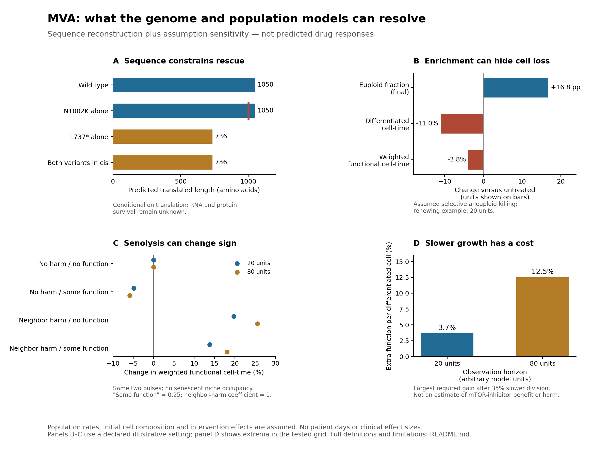

# Genome-informed Track 2 computation

This directory retains the completed sequence reconstruction and population
sensitivity analysis supporting the [Track 2 proposal](../../reports/jeweled_track2_report_submission.md)
and its [evidence pipeline](../../reports/appendices/track2-evidence-pipeline.md).
The computation informs experimental endpoints. It does **not** infer mTOR activity
from sequence, predict named-drug efficacy or rank candidate medications.

## Replay

Python 3.9+ standard library; no network, alignments or patient genome files are
needed for population replay. Choose an output directory that does not yet exist:

```sh
bash workflow/track2-model/run.sh /tmp/mva-track2-replay
```

That command uses the retained, reference-checked allele products. To independently
reconstruct the transcript first, provide the existing pinned uncompressed GRCh38
FASTA and its `.fai` index as the optional second argument:

```sh
bash workflow/track2-model/run.sh /tmp/mva-track2-full-replay /path/to/GRCh38_nochr.fa
```

The full reference is not bundled or downloaded. `alleles.py` checks its complete
identity and the included public Ensembl inputs. `MVA_MODEL_PYTHON` can select the
Python executable. Simulation ran on a Mac Studio with Python 3.9.6; plotting used
matplotlib 3.10.8 locally. The code has no macOS-specific simulation dependency;
a full Linux run of this model package has not been verified.

## Sequence findings

ENST00000287598.11 / Ensembl 116 / GRCh38 has 23 exons and a 3,153-nucleotide CDS.
The reconstructed spliced reference matches the entire public CDS. Both nominated
reference bases and coding positions were checked directly.

| Conditional allele | Canonical product if translated |
|---|---|
| Wild type | 1,050 amino acids |
| c.2210T>G / Leu737Ter | TTA→TGA; 736 native amino acids |
| c.3006T>G / Asn1002Lys | AAT→AAG; 1,050 amino acids, one N→K substitution |
| Both changes in cis | Same 736-amino-acid stop product; N1002K is masked |

Confirmed cis gives `[L737Ter;N1002K]/WT` at the nominated pair and retires it as
the compound-heterozygous MVA1 explanation. Retaining a BUB1B causal explanation
would require an independently demonstrated additional pathogenic allele in trans or
dominant mechanism. The cis sequence calculation is a conditional product model,
not evidence that this configuration explains the case or permits advancing the
current biallelic drug rationale.

The premature stop is 746 spliced nucleotides before the last exon junction,
satisfying the positional NMD rule. Actual decay, translation, protein function
and phase remain unknown. These are conditional products reconstructed from a
public reference and two candidate selectors, not sequenced patient transcripts.
Alternative splicing, readthrough and reinitiation are not modeled.

An additive sensitivity calculation varies unmeasured abundance/function. It
establishes only conditional algebra: increasing missense-product abundance does
nothing if its activity is zero or its canonical translation is masked in cis.
There is no calibrated protein-dose-to-error-rate connection.

## Population assumptions and findings

The model separates dividing progenitors, differentiated cells and senescent
cells; each has euploid and aneuploid states. Both retain the constitutional BUB1B
genotype. An assumed error creates abnormal daughters; there is no automatic
genetic correction. Differentiation, senescence, death and crowding affect output.
All abnormal karyotypes are collapsed: no allele-copy changes, LOH, chromosome-specific
fitness, tumor evolution, systemic pharmacology or muscle mechanics are simulated.

There are 96 parameter settings × two horizons × eight arms. Horizons of 20 and
80 are arbitrary model units, not patient days. Initial cell numbers/composition,
division and loss rates, functional weights and intervention effects are assumptions.
The error-probability range overlaps **simulation inputs**, not measured case
rates, in [Rozhok 2020](https://doi.org/10.1038/s41598-020-68729-1).
This is an independent model, not a reproduction of that study or a fit to
[Pfau's mouse transplant data](https://doi.org/10.1101/gad.278820.116).

The grid uses error probabilities 0.005/0.02/0.04, aneuploid division ratios
0.7/1.8, initial senescence 0/25%, senescence-associated impairment 0/1 and
senescent contribution 0/0.25, with renewing/nonrenewing compartments. The
division ratios straddle the model's baseline selection boundary of 1.415–1.523.
Every parameter and intervention definition is explicit in [population.py](population.py).
Initial 20% aneuploidy is **not** inferred from VAF or the retracted depth signal.

Report raw differentiated-cell time and absolute counts alongside weighted function.
The latter integrates `(D_E + 0.5 D_A + fS S)/(1 + lambda S/K)` and is not measured
tissue function. All S cells receive the assumed contribution, including those
originating from progenitors. Grid frequencies are not probabilities.



In the displayed renewing example, selective abnormal-cell killing raises euploid
fraction 16.8 percentage points while raw differentiated-cell time falls 11.0%.
The senolysis sign depends on assumed neighbor impairment and contribution of the
removed cells; raw differentiated-cell time is unchanged in those contrasted
examples. With assumed 35% slower division alone, the largest compensating
per-differentiated-cell function gains needed to break even are 3.7% and 12.5%
across the two horizons. They are not everolimus effect estimates or contractile
force thresholds. Finite pulse-removal arms and continuous arms are not matched
drug exposures. Error reduction cannot benefit a compartment that never divides.

Recorded numerical checks show maximum accounting discrepancy of 3.55×10⁻¹¹ and
maximum checked timestep-refinement difference of 0.156%. These establish numerical
behavior only. Population output includes explicit limitations, all scenarios,
illustrative trajectories and a separate senescent-niche sensitivity.

## Files and scope

- `alleles.py`, `public-transcript/`, `allele-inputs.json`: reconstruction source,
  public Ensembl responses, and conditional candidate products.
- `population.py`, `population-results.json`: assumptions and completed results.
- `run.sh`: replay using retained products or an independently checked reference.
- `plot_results.py`, `model-findings.png`, `model-findings.pdf`: figure source and
  outputs; plotting does not run simulations.

The imported computational source/result bytes are unchanged from the completed
analysis. Replay changes runtime timestamps and, after fresh reconstruction,
the allele-input digest; scientific fields can be compared excluding those metadata.
This selected package contains limited case-associated candidates, public-reference
sequences and assumed cell populations. It contains no raw case reads or
genome-scale genotypes. Publication permissions and attribution remain governed
by [report provenance](../../reports/PROVENANCE.md).
