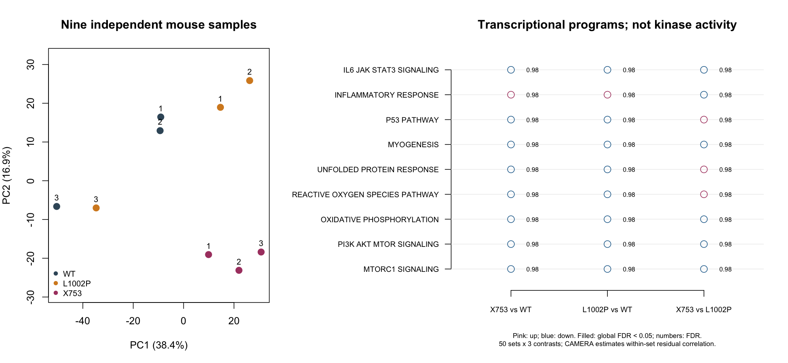

# Public mouse muscle analysis for Track 2

This secondary analysis tests the specificity of the transcriptional rationale
behind the proposed mTORC1 route. It uses GSE134781: three independent mice per
genotype (WT, BubR1+/L1002P, BubR1+/X753), age three months, gastrocnemius. It is
neither a patient experiment nor independent biological replication of the study.

## Finding: no positive transcriptional corroboration for mTORC1

The analysis retained **12,989 of 24,062 genes**. None of the 150 planned
Hallmark/contrast tests met global FDR <0.05; the smallest adjusted value was
0.9825. For the mTORC1 set, 185/199 genes were retained:

| Comparison | CAMERA direction relative to background | Raw P | Global FDR | Median gene log2 fold change |
|---|---|---:|---:|---:|
| X753 vs WT | Down | 0.2190 | 0.9825 | −0.0850 |
| L1002P vs WT | Down | 0.2256 | 0.9825 | −0.0479 |
| X753 vs L1002P | Down | 0.6650 | 0.9825 | −0.0161 |

This does **not** establish suppressed or normal mTORC1 activity. CAMERA asks
whether a program differs relative to the expressed-gene background; it does not
test phosphorylation, causal dependence or pathway equivalence. Median fold
changes are descriptive and are not the CAMERA test statistic. The deposited
counts supply no positive Hallmark support for this mechanism under this
analysis. The paper's monoallelic-carrier blot is a separate qualitative band
observation with no total-substrate ratios, quantification or inferential test;
it does not demonstrate increased pathway activity.

No mTORC1 contrast passed any of the 12 sensitivity analyses. For X753–WT its
direction stayed down; X753–L1002P changed direction once after leaving one mouse
out. Fixed correlation 0.01 produced positive tests in other programs, including
lower oxidative-phosphorylation transcription in **both** mutants versus WT; the
estimated-correlation primary did not. That assumption-sensitive finding cannot
justify selecting elamipretide or claiming a measured respiratory defect.

The gene-level analysis detected 34 up/21 down genes for X753–WT and 2 up/0 down
for L1002P–WT using **within-contrast** FDR <0.05 and |log2FC| >0.45. Applying BH
over all genes and all three contrasts gives 14 up/8 down for X753–WT. These are
different analysis families, not reproductions of the original DEG counts.
The stronger X753 gene-level signal does not identify its causal pathway.



All [pathway results](results/pathways.tsv), [sensitivity results](results/sensitivity.tsv),
[gene effects and pointwise intervals](results/gene-results.tsv.gz),
[sample counts and normalization](results/samples.tsv),
[mean–variance quality check](results/voom-quality-check.png),
[gene-set coverage](results/tested-membership.tsv) and
[overlap](results/set-overlap.tsv) are retained. No sample was discarded.
Samples differ within WT and L1002P as well as between groups; unidentified batch
or composition effects cannot be excluded. TMM factors ranged 0.886–1.082.

**Decision consequence:** this analysis supplies no additional transcriptional
support for mTORC1 and no affirmative support for a rival. It does not rebut the
qualitative phosphoprotein-band observation or measure kinase activity. The
[current proposal](../../reports/jeweled_track2_report_submission.md) selects everolimus
and niacin as distinct drug hypotheses on their broader evidence, with functional
qualification still required. These interpretation boundaries do not alter any
statistical result.

## Analysis choices fixed before inspecting the pathway results

- All 50 mouse Hallmark sets, MSigDB 2025.1.Mm; no handpicked positive gene list.
- Three contrasts: X753–WT, L1002P–WT, X753–L1002P. Genotype-only design because
  recorded sex, batch, litter and cage covariates are unavailable.
- edgeR filterByExpr, TMM normalization, limma-voom; CAMERA with estimated residual
  inter-gene correlation, variance inflation floored at one. Returned raw
  correlations can be negative; an effective correlation column records the
  floor used in testing. BH adjustment over
  all 150 set/contrast tests. Gene tests use moderated estimates and retain both
  within-contrast and global gene-test FDR; their 95% intervals are pointwise.
  Robust eBayes applies to the gene tables; CAMERA performs its own moderation.
- Sensitivities: omit each mouse once using the fixed primary gene universe;
  paper's mean-count ≥10 filter; RLE normalization; fixed 0.01 correlation. Each
  sensitivity retains all 150 tests and is not a new discovery opportunity.
- Display mTORC1, PI3K–AKT–mTOR, oxidative phosphorylation, ROS response, unfolded
  protein response, myogenesis, p53, inflammatory and IL6–JAK–STAT3 programs.
  These are orthology-mapped, overlapping transcriptional programs, not specific diagnostic tests
  for senescence, mitochondrial dysfunction, cell composition or kinase activity.

## Replay

Provide Python 3 and R with limma, edgeR and statmod. The executed environment
uses R 4.4.3, limma 3.62.1, edgeR 4.4.0 and statmod 1.5.2 on a Mac Studio (arm64).
One isolated conda environment can be created with:

```sh
micromamba create -y -p /absolute/path/to/rna-env -c conda-forge -c bioconda \
  --strict-channel-priority r-base=4.4.3 bioconductor-limma=3.62.1 \
  bioconductor-edger=4.4.0 r-statmod=1.5.2
MVA_RNA_RSCRIPT=/absolute/path/to/rna-env/bin/Rscript \
  bash workflow/track2-rna/run.sh /absolute/path/to/new-output
```

The launcher downloads and checks the retained identities of counts, deposited metadata and gene sets directly from
NCBI/Broad public archives, then runs the analysis. No case data or FASTQ download
is needed. [Exact Mac environment packages](environment-osx-arm64.txt) and
[R session](results/session-info.txt) are retained. Linux was not executed.

## Sources and interpretation

- [Sieben et al., Fig. 5 and methods](https://www.jci.org/articles/view/126863/version/2);
  [GEO GSE134781](https://www.ncbi.nlm.nih.gov/geo/query/acc.cgi?acc=GSE134781).
- [voom](https://pmc.ncbi.nlm.nih.gov/articles/PMC4053721/) and
  [CAMERA](https://pmc.ncbi.nlm.nih.gov/articles/PMC3458527/): competitive testing
  accounts for within-set gene correlation; it does not infer causal pathways.
- [MSigDB mouse Hallmark](https://www.gsea-msigdb.org/gsea/msigdb/mouse/collections.jsp#MH)
  and [release used](https://data.broadinstitute.org/gsea-msigdb/msigdb/release/2025.1.Mm/).

The Hallmark gene-set membership/overlap outputs derive from MSigDB, copyright
Broad Institute, MIT and Regents of the University of California, under
[CC BY 4.0 and MSigDB terms](https://www.gsea-msigdb.org/gsea/msigdb_license_terms.jsp).
Changes here are exact-symbol matching and expression filtering, followed by
statistical summaries. These third-party terms are retained separately from the
repository code license. The raw GMT and public count matrix are downloaded at
replay rather than redistributed in this directory.

This is a modern secondary analysis, not exact reproduction of the original
DESeq2 1.10.1/STRING analysis or its 336-versus-3 DEG counts. Unknown batch and bulk
cell composition remain potential confounders. The older biallelic cohort is not
pooled with these mice. Low Cdkn2a detection cannot exclude rare senescent cells.
